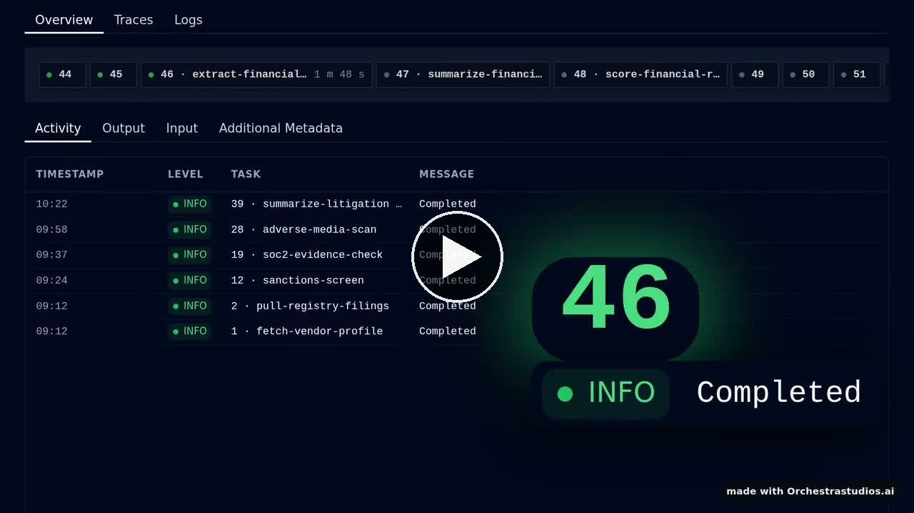

https://github.com/user-attachments/assets/6b33a853-5f3e-4c10-9b8f-2dc95332b4d5

[](https://orchestrastudios.ai/films/hatchet)

## 🎬 We made Hatchet a film

Hi Hatchet team — I'm Remy Tennant, founder of Orchestra Studios. This is a gift — a film we made specially for your company, directed from your product itself: your actual screens, in motion.

We're running a promotional campaign: **we're giving away 100 videos to YC companies over the next 30 days, first come, first served.** We came to you first because we admire Hatchet's elegant bet on Postgres as the durability layer for both the task runtime and the observability system — durable tasks, DAGs, retries and fair scheduling that stay genuinely easy to self-host. The film proves the bet the only honest way: an agent crashes at step 47, and Hatchet picks it up at step 47. So we went ahead and made yours — the short film above. I think it came out great, and I'd love you to have it.

**Use it as-is, or claim it and get the real thing:**
- This copy is yours either way. Want just the video? Trim the outro card off the end and use it — no signup, no strings. It's 720p only because GitHub caps README videos at 10 MB; that's the whole reason, not a teaser.
- **Claim it at [orchestrastudios.ai/YC](https://orchestrastudios.ai/YC)** and you get the full 1080p master — plus the project itself, transferred to you the moment you sign up.
- Claiming means the film becomes *code you own*, not a file you're stuck with: edit any scene, line or voice, re-audition, re-render as often as you like. When your product changes, it can re-render from your code, so it never goes stale.
- Want changes? Just tell me what you'd fix — I'll hand it to the AI agent embedded in the project. It makes the edits and re-renders. First round's on us, no sweat.

**No strings attached.** No card, no sales call, no deadline on the gift itself — the film above is yours whether or not you ever claim the project. Why free? Orchestra just launched, and this is our launch campaign: we're giving a film to 100 YC companies, first come first served. We're YC founders ourselves, so we started with our own community — and a claimed project is worth more to us than a fee. That's the whole exchange.

Questions? Email me at **remy@orchestrastudios.ai**.

— Remy Tennant
Orchestra Studios

---

<div align="center">
<a href ="https://hatchet.run?utm_source=github&utm_campaign=readme">
<picture>
  <source media="(prefers-color-scheme: dark)" srcset="./assets/hatchet_logo_dark.svg">
  
</picture>
</a>

### An orchestration engine for background tasks, AI agents, and durable workflows

[](https://docs.hatchet.run) [](https://opensource.org/licenses/MIT) [](https://pkg.go.dev/github.com/hatchet-dev/hatchet) [](https://www.npmjs.com/package/@hatchet-dev/typescript-sdk)

[](https://hatchet.run/discord)
[](https://twitter.com/hatchet_dev)
[](https://github.com/hatchet-dev/hatchet)

  <p align="center">
    <a href="https://cloud.hatchet.run?utm_source=github&utm_medium=readme">Hatchet Cloud</a>
    ·
    <a href="https://docs.hatchet.run">Documentation</a>
    ·
    <a href="https://hatchet.run">Website</a>
    ·
    <a href="https://github.com/hatchet-dev/hatchet/issues">Issues</a>
  </p>

</div>

### What is Hatchet?

Hatchet is a platform for orchestrating background tasks, AI agents, and durable workflows at scale. It supports applications written in Python, TypeScript, Go and Ruby, and can be used as a service through [Hatchet Cloud](https://cloud.hatchet.run?utm_source=github&utm_medium=readme) or [self-hosting](https://docs.hatchet.run/self-hosting). Hatchet provides a full platform for queuing, automatic retries, durability, real-time monitoring, alerting, and logging.

### Get started quickly

The fastest way to get started with Hatchet is signing up for [Hatchet Cloud](https://cloud.hatchet.run?utm_source=github&utm_medium=readme) to try it out! We recommend this even if you plan on self-hosting, so you can have a look at what a fully-deployed Hatchet platform looks like.

To run Hatchet locally, the fastest path for setup is to install the Hatchet CLI (on MacOS, Linux or WSL) - note that this requires [Docker](https://www.docker.com/get-started) installed locally to work:

```sh
curl -fsSL https://install.hatchet.run/install.sh | bash
hatchet --version
hatchet server start
```

To view full documentation for self-hosting and using cloud, have a look at the [docs](https://docs.hatchet.run).

### When should I use Hatchet?

You can use Hatchet for running background tasks, AI agents, or other types of long-running workflows. It is designed to be a feature-complete solution for systems where **correctness, reliability, horizontal scalability, and observability** are essential. From a technical perspective, it differs from other solutions in that it uses Postgres as a durability layer for both the task runtime and the observability system, making it particularly easy to self-host.

For some end-to-end examples of workflows you can build with Hatchet, check out our [cookbooks](https://docs.hatchet.run/cookbooks).

### Hatchet Features

#### Background Tasks

- [Background tasks](https://docs.hatchet.run/v1/tasks): Hatchet supports one-off background tasks defined as simple functions. It supports both fire-and-forget and fire-and-wait tasks with subscriptions
- [Retries](https://docs.hatchet.run/v1/retry-policies): flexible and configurable retry policies for tasks, with optional [exponential backoff](https://docs.hatchet.run/v1/retry-policies#exponential-backoff)
- [Cron jobs](https://docs.hatchet.run/v1/cron-runs) and [scheduled runs](https://docs.hatchet.run/v1/scheduled-runs) for scheduling tasks at some point in the future
- [Task routing](https://docs.hatchet.run/v1/advanced-assignment/worker-affinity) based on strict conditions, like **worker labels**, or more complex, weighted scheduling rules using **worker affinity**
- [Event-based triggering](https://docs.hatchet.run/v1/events) and [listeners](https://docs.hatchet.run/v1/durable-event-waits) to build event-driven, highly distributed systems
- [Webhook-based triggering](https://docs.hatchet.run/v1/webhooks) for easily triggering Hatchet tasks from upstream data sources

#### Task orchestration and workflows

- [Durable tasks](https://docs.hatchet.run/v1/durable-tasks) for building fault-tolerant, long-running workflows which can easily recover from failure
- [DAGs (directed acyclic graphs)](https://docs.hatchet.run/v1/directed-acyclic-graphs) for building data pipelines and simple workflows. See [our guide](https://docs.hatchet.run/cookbooks/durable-tasks-vs-dags) on choosing between durable tasks and DAGs
- Complex pause/resume conditions using [durable sleep](https://docs.hatchet.run/v1/durable-sleep), [event waits](https://docs.hatchet.run/v1/durable-event-waits), or a combination of both

#### Scale

- [Priority](https://docs.hatchet.run/v1/priority) so that critical tasks can run before tasks which aren't latency sensitive, like backfill jobs
- [Rate limiting](https://docs.hatchet.run/v1/rate-limits) to deal with third-party APIs, or even to enforce per-user rate limits using **dynamic rate limits**
- [Fair scheduling](https://docs.hatchet.run/v1/concurrency) using Hatchet's concurrency policies, which can set a concurrency limit for tasks based on dynamic keys
- [Worker slots](https://docs.hatchet.run/v1/workers#slots) for ensuring that workers cannot take on more work than they can handle

#### Monitoring, observability, and management

- Real-time web UI with alerting, monitoring, and logging
- [OpenTelemetry](https://docs.hatchet.run/v1/opentelemetry) (using Hatchet's built-in collector or external destinations)
- [Prometheus metrics](https://docs.hatchet.run/v1/prometheus-metrics)
- **Multi-tenant** by default, so a single Hatchet instance can support multiple teams
- Users and roles

#### [Hatchet Cloud](https://cloud.hatchet.run?utm_source=github&utm_medium=readme) features

- Autoscaling and pay-as-you-go plans
- Multi-region deployments
- SSO
- Improved performance for monitoring, logging, and observability

### Documentation

The most up-to-date documentation can be found at https://docs.hatchet.run.

### Community & Support

- [Discord](https://discord.gg/ZMeUafwH89) - best for getting in touch with the maintainers and hanging with the community
- [Github Issues](https://github.com/hatchet-dev/hatchet/issues) - used for filing bug reports
- [Github Discussions](https://github.com/hatchet-dev/hatchet/discussions) - used for starting in-depth technical discussions that are suited for asynchronous communication
- [Email](mailto:contact@hatchet.run) - best for getting Hatchet Cloud support and for help with billing, data deletion, etc.

### Hatchet vs...

<details>
<summary>Hatchet vs Durable Execution Platforms (Temporal, DBOS)</summary>

####

Hatchet's [durable tasks](https://docs.hatchet.run/v1/durable-tasks) feature is a drop-in replacement for Temporal or DBOS workflows. You also get:

- End-to-end observability of durable tasks using OpenTelemetry, monitoring and logging
- Features built for running workflows at scale, such as rate limiting, complex routing, and worker-level slot control
- Multi-tenancy, users and roles supported out of the box

In addition to making durable execution easier to use, Hatchet can also be used as a general-purpose queue, a DAG-based orchestrator, a durable execution engine, or all three, allowing teams to centralize their async and background processing in a single platform.

</details>

<details>

<summary>Hatchet vs Task Queues (Celery, BullMQ)</summary>

####

Traditional task queues like BullMQ and Celery trade off durability for throughput. Tasks persist on the broker (typically Redis or RabbitMQ) while the task is executing, but are not persisted afterwards. This makes it difficult to build complex workflows, as there is no persistent intermediate state. It also makes it difficult to recover and replay tasks which failed and were removed from the queue, resulting in custom admin tooling to work with these libraries at scale.

On the other hand, Hatchet is a _durable_ task queue, meaning it persists the history of all executions (up to a defined retention period), which allows for easy monitoring, debugging and durable task features. Hatchet's durability features add some overhead: while Hatchet has been load-tested up to 10k tasks/second, it consumes more resources than a system built on Redis or RabbitMQ, which can reach much higher throughput.

</details>

<details>

<summary>Hatchet vs DAG-based platforms (Airflow, Prefect, Dagster)</summary>

####

These tools are usually built with data engineers in mind, and aren’t designed to run as part of a high-volume application. They’re usually higher latency and higher cost, with their primary selling point being integrations with common datastores and connectors.

**When to use Hatchet:** when you'd like to use a DAG-based framework, write your own integrations and functions, and require higher throughput (>100/s)

**When to use other DAG-based platforms:** when you'd like to use other data stores and connectors that work out of the box

</details>

### Issues

Please submit any bugs that you encounter via GitHub issues.

### I'd Like to Contribute

Please let us know what you're interested in working on in the #contributing channel on [Discord](https://discord.gg/ZMeUafwH89). This will help us shape the direction of the project and will make collaboration much easier!
