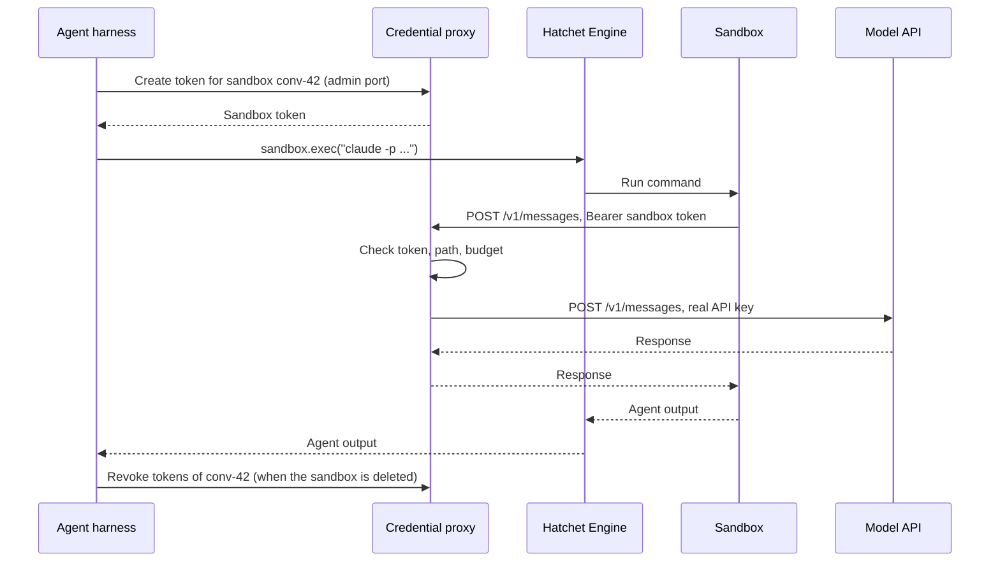

import { Callout, Steps } from "@/components/nextra-compat";

# Credentials for Sandboxed Agents

When an authenticated process runs inside a [Hatchet sandbox](/v1/sandboxes), it needs a token or an API key. This cookbook shows how to keep those credentials out of the sandbox.

<Callout type="warning">
  Sandboxes are a Labs feature and may change in future releases. In the
  dashboard, open <strong>Settings</strong>, go to <strong>Labs Preview</strong>{" "}
  and turn on <strong>Sandboxes</strong>.
</Callout>

## The pattern

Using a **credential proxy** removes the need for the sandbox to have access to real credentials. The proxy runs outside the sandbox, holds the real keys, and adds them to the sandbox's requests:

1. When the harness creates a sandbox, it asks the proxy for a **sandbox token**: a random string tied to that sandbox, with no value outside the proxy.
2. The agent in the sandbox calls the proxy with the sandbox token instead of the real key, for example with `ANTHROPIC_BASE_URL` pointing at the proxy.
3. The proxy checks the token, checks the request against what the sandbox may do, replaces the token with the real key, and forwards the request.
4. When the sandbox is deleted, the harness revokes its token.

The sandbox's network must allow the proxy and nothing else; otherwise, the agent can skip the proxy and send data anywhere.



## Why a token per sandbox is enough

Assume the sandbox token may leak. Every `exec` is a Hatchet task, and its command is stored as task input that anyone with access to the tenant can read. A background process started by an earlier command also keeps running as the same user, and can read the environment of later commands from `/proc`.

A leaked token is still worth little. The proxy's model port can only be reached from the sandbox network, so a copied token doesn't work anywhere else. Inside the sandbox, the token only grants the same permissions the agent already has: it is scoped to one sandbox, expires when that sandbox is deleted, and is limited to the sandbox's budget and the hosts and paths the proxy allows.

## Setup

<Steps>

### Run a credential proxy

The proxy runs outside the sandbox, in your own infrastructure. It needs two listeners:

- **An admin port** that only the harness can reach, to create and revoke sandbox tokens.
- **A model port** that the sandboxes can reach, to forward their requests.

Production-grade options include [LiteLLM](https://github.com/BerriAI/litellm) (virtual keys with per-key budgets), and [Envoy](https://www.envoyproxy.io/) with its `credential_injector` filter. The sketch below shows the whole contract in Express 5, to make it clear what the proxy must do:

```bash
npm install express@^5
```

```ts
import express, { type Request } from "express";
import { randomBytes } from "node:crypto";
import { Readable } from "node:stream";
import { pipeline } from "node:stream/promises";
import type { ReadableStream } from "node:stream/web";

const API_KEY = process.env.ANTHROPIC_API_KEY!; // only the proxy holds the real key
const UPSTREAM = "https://api.anthropic.com";
// The exact upstream paths sandboxes may call.
const ALLOWED_PATHS = ["/v1/messages", "/v1/messages/count_tokens"];
// brickie's sandbox ID format.
const SANDBOX_ID = /^[a-z0-9][a-z0-9-]{0,62}$/;

// Keep tokens in a database in production, so a restart does not bring a
// revoked token back.
const tokens = new Map<string, { sandboxId: string }>();

function sandboxIdOf(req: Request) {
  const id = req.query.sandbox;
  return typeof id === "string" && SANDBOX_ID.test(id) ? id : undefined;
}

// Admin port: reachable by the harness only.
const admin = express();

admin.post("/tokens", (req, res) => {
  const sandboxId = sandboxIdOf(req);
  if (!sandboxId) return res.sendStatus(400);
  const token = randomBytes(32).toString("hex");
  tokens.set(token, { sandboxId });
  res.status(201).json({ token });
});

admin.delete("/tokens", (req, res) => {
  const sandboxId = sandboxIdOf(req);
  if (!sandboxId) return res.sendStatus(400);
  for (const [token, grant] of tokens)
    if (grant.sandboxId === sandboxId) tokens.delete(token);
  res.sendStatus(204);
});

// Loopback here; in production, an interface only the harness can reach.
admin.listen(9001, "127.0.0.1");

// Model port: reachable by the sandboxes only.
const proxy = express();

proxy.use((req, res, next) => {
  const token = req.get("authorization")?.replace(/^Bearer /, "");
  const grant = token ? tokens.get(token) : undefined;
  if (!grant) return res.status(401).send("unknown or revoked sandbox token");
  res.locals.sandboxId = grant.sandboxId;
  next();
});

// Model requests carry the whole conversation: raise the 100 kB default.
proxy.use(express.raw({ type: "*/*", limit: "32mb" }));

for (const path of ALLOWED_PATHS) {
  proxy.post(path, async (req, res) => {
    // Check the sandbox's budget here, and log the request with
    // res.locals.sandboxId.
    // Forward to UPSTREAM plus the route's own path, never to req.url. A
    // request for http://evil.example/v1/messages must not send the real key
    // to another host, and /v1/messages/../models must not reach another
    // endpoint.
    const upstream = await fetch(UPSTREAM + path, {
      method: "POST",
      headers: {
        "content-type": "application/json",
        "anthropic-version": req.get("anthropic-version") ?? "2023-06-01",
        ...(req.get("anthropic-beta")
          ? { "anthropic-beta": req.get("anthropic-beta")! }
          : {}),
        "x-api-key": API_KEY,
      },
      body: req.body,
    });
    res
      .status(upstream.status)
      .set(
        "content-type",
        upstream.headers.get("content-type") ?? "application/json",
      );
    if (upstream.body)
      await pipeline(Readable.fromWeb(upstream.body as ReadableStream), res);
    else res.end();
  });
}

// Every other method and path is refused.
proxy.use((req, res) => res.sendStatus(403));

// Only the sandboxes may reach this port: see the ingress policy below.
proxy.listen(8080);
```

The sandbox talks to the proxy over plain HTTP, so the proxy can read and change the request without intercepting TLS, and the sandbox needs no extra CA certificate. Run the model port on a private network that only the sandboxes reach.

### Allow the sandboxes to reach only the proxy

Run the provider on Kubernetes with the `brickie` Helm chart from [hatchet-charts](https://github.com/hatchet-dev/hatchet-charts). Turn off all sandbox egress, then allow the proxy:

```yaml
sandbox:
  egress: none
networkPolicy:
  allowDNS: false
  egressCIDRs:
    - 10.20.30.0/28 # the proxy's addresses
```

Name the addresses of the proxy itself. Kubernetes does not define whether an `ipBlock` rule matches a Service's cluster IP, and network plugins differ, so do not use the Service IP. Pod IPs change when a pod is rescheduled, so give the proxy addresses that stay put, such as a dedicated subnet or node pool, or run it outside the cluster at a fixed address. NetworkPolicy is only enforced by a network plugin that implements it.

The egress rules control what the sandboxes reach, not who reaches the proxy. Restrict that too, so a token copied from task input is useless outside the sandboxes. If the proxy runs in the cluster, allow its model port only from sandbox pods, and its admin port only from the harness:

```yaml
apiVersion: networking.k8s.io/v1
kind: NetworkPolicy
metadata:
  name: credential-proxy-ingress
  namespace: credential-proxy
spec:
  podSelector:
    matchLabels:
      app: credential-proxy
  policyTypes:
    - Ingress
  ingress:
    - from: # sandbox pods, in the brickie release's namespace
        - namespaceSelector:
            matchLabels:
              kubernetes.io/metadata.name: brickie
          podSelector:
            matchExpressions:
              - key: agents.x-k8s.io/sandbox-name-hash
                operator: Exists
      ports:
        - port: 8080
    - from: # the agent harness
        - namespaceSelector:
            matchLabels:
              kubernetes.io/metadata.name: agents
          podSelector:
            matchLabels:
              app: agent-harness
      ports:
        - port: 9001
```

With this policy, bind the sketch's admin port to the pod's address instead of loopback. If the proxy runs outside the cluster, apply the same rule with a firewall: the model port only from a node pool that runs nothing but sandboxes, and the admin port only from the harness.

<Callout type="info">
  The Docker driver has no egress control: a Docker sandbox can reach anything
  your machine can. Use it to develop against the proxy, not to contain an
  untrusted agent.
</Callout>

### Create the sandbox and its token

Use an image that has the agent installed, for example an image built from `node:24` with `npm install -g @anthropic-ai/claude-code`. The harness creates the sandbox and gets a token for it from the proxy:

```ts
import { HatchetClient } from "@hatchet-dev/typescript-sdk/v1";
import "@hatchet-dev/sandbox";

export const hatchet = HatchetClient.init();
export const AGENT_IMAGE = "registry.example.com/agent-claude-code:1";
const PROXY_ADMIN = "http://credential-proxy-admin:9001";
const PROXY_URL = "http://10.20.30.4:8080"; // the proxy's IP, as the sandbox reaches it

export async function startAgentSandbox(conversationId: string) {
  const sandbox = await hatchet.sandbox.create({
    id: `conv-${conversationId}`,
    template: AGENT_IMAGE,
    metadata: { conversation: conversationId },
  });

  const res = await fetch(
    `${PROXY_ADMIN}/tokens?sandbox=${sandbox.sandboxId}`,
    { method: "POST" },
  );
  const { token } = (await res.json()) as { token: string };

  return { sandboxId: sandbox.sandboxId, token };
}

// The agent's environment, set on every turn's command. The harness writes
// the token to no file, so it does not reach snapshots that way, and a
// sandbox started again from a snapshot needs nothing restored.
export function agentEnv(token: string) {
  return [
    `ANTHROPIC_BASE_URL=${PROXY_URL}`,
    `ANTHROPIC_AUTH_TOKEN=${token}`,
    "CLAUDE_CODE_DISABLE_NONESSENTIAL_TRAFFIC=1",
    "CLAUDE_CONFIG_DIR=/workspace/.claude-state",
  ].join(" ");
}
```

- `ANTHROPIC_AUTH_TOKEN` makes Claude Code send the sandbox token as a bearer token. Do not set `ANTHROPIC_API_KEY` in the sandbox.
- `CLAUDE_CODE_DISABLE_NONESSENTIAL_TRAFFIC` stops Claude Code from calling hosts other than the model API, which the egress rules block anyway.
- `CLAUDE_CONFIG_DIR=/workspace/.claude-state` keeps Claude Code's sessions in the workspace, so `--resume` works after the sandbox is started again from a snapshot. Put the repository in `/workspace/repo`, so this directory is not inside it and cannot be committed, and the repository's own `.claude/` settings stay project settings.
- Session transcripts record every tool output, and the workspace is in every snapshot. If the agent prints its environment, the token ends up in snapshots. A revoked token is useless, so revoke it when you delete the sandbox. Never run `claude login` or `/login` in the sandbox: it writes a credential file to this directory.

### Run the agent

Each turn of the agent is one `exec`, with the agent's environment set in the same command:

```ts
import { AGENT_IMAGE, agentEnv, hatchet } from "./sandbox";

const shellQuote = (s: string) => `'${s.replaceAll("'", `'\\''`)}'`;

// Connect before every turn: it starts the sandbox again if it idled out,
// and it needs the image to do so.
const sandbox = await hatchet.sandbox.connect(sandboxId, {
  template: AGENT_IMAGE,
});
const result = await sandbox.exec(
  `export ${agentEnv(token)} && cd /workspace/repo && ` +
    `claude -p ${shellQuote(prompt)} --output-format json ` +
    `--permission-mode acceptEdits --allowedTools Bash`,
  { timeoutMs: 15 * 60 * 1000 },
);
if (result.exitCode !== 0)
  throw new Error(`agent turn failed (${result.exitCode}): ${result.stderr}`);
const { result: answer, session_id } = JSON.parse(result.stdout);
```

In print mode (`-p`), nobody can approve a tool call, so Claude Code refuses the ones that need approval. `--permission-mode acceptEdits` allows file edits and `--allowedTools Bash` allows shell commands. The sandbox, not Claude Code's permission prompts, is what contains the agent.

Pass `--resume <session_id>` on the next turn to continue the same conversation. The command's output arrives when the command ends, so set `timeoutMs` to the longest turn you allow. A turn that runs past it is killed and returns exit code 124.

### Proxy git and package registries the same way

Point git and npm at the proxy over plain HTTP, with the sandbox token, and let the proxy add the GitHub or registry token for the repositories and packages this sandbox may use. Here `$SANDBOX_TOKEN` is the token from `startAgentSandbox`, set in the command's environment like `agentEnv`:

```bash
git -c url."http://10.20.30.4:8080/github/".insteadOf=https://github.com/ \
  -c http.extraHeader="Authorization: Bearer $SANDBOX_TOKEN" \
  clone https://github.com/acme/app.git /workspace/repo
npm install --registry=http://10.20.30.4:8080/npm/ \
  "--//10.20.30.4:8080/npm/:_authToken=$SANDBOX_TOKEN"
```

The sketch above proxies only the model API. Each of these needs its own route on the proxy, which checks the sandbox token the same way, allows only that sandbox's repositories or packages, and adds the real credential.

Pass the settings on the command line or in the command's environment, not in `.gitconfig` or `.npmrc` in the workspace.

For powerful operations, such as a deploy or a database write, do not proxy the credential at all. Give the agent a tool that runs outside the sandbox, such as a Hatchet task exposed as described in [Hatchet Agent Tools](/cookbooks/hatchet-and-mcp), and check each call there.

### Revoke the token with the sandbox

Revoke the sandbox's tokens when you delete it:

```ts
await hatchet.sandbox.delete({ sandboxId: sandbox.sandboxId });
await fetch(`${PROXY_ADMIN}/tokens?sandbox=${sandbox.sandboxId}`, {
  method: "DELETE",
});
```

A sandbox that idles out stops but is not deleted, and `connect` can start it again. Keep its token until you delete the sandbox, or revoke it when the sandbox stops and create a new one after the next `connect`.

</Steps>

## Check that it holds

Test these from inside a sandbox before you trust the setup:

1. **The token works through the proxy.** The agent's first model call succeeds.
2. **Nothing else is reachable.** A direct connection to the model API's address fails, while a connection to the proxy succeeds. Connect by IP address, so a DNS failure cannot pass for a blocked connection. A DNS lookup of any name fails too.
3. **A revoked token is dead.** After you revoke it, the proxy answers `401` to the same token.
4. **Sandboxes are separate.** A second sandbox gets its own token, and its token cannot be used for the first sandbox's budget.
5. **No credential is stored.** No real key appears in task inputs in the Hatchet dashboard, and no token appears in a snapshot.

## Limits of this pattern

- **The agent can still misuse what it is allowed.** The proxy limits where requests go and how much they cost, not what is in them. An agent can put workspace contents into a model request or a git push it is allowed to make. Allow only the hosts, paths and repositories the sandbox needs.
- **Leftover processes.** A process left by an earlier command can use the current token for as long as the sandbox runs. Revocation and the two rules above bound what that gives an attacker.
- **The admin port must be out of reach.** If a sandbox can reach the admin port, it can create tokens. Put it on a listener and network the sandboxes cannot reach, not behind a password on the same port.
- **Revocations must persist.** A proxy that keeps revocations in memory forgets them when it restarts.

## Next steps

- [Sandboxes](/v1/sandboxes): the basics of Hatchet sandboxes.
- [Securely deploying AI agents](https://code.claude.com/docs/en/agent-sdk/secure-deployment): Anthropic's guide to isolation and credential management for agents.
