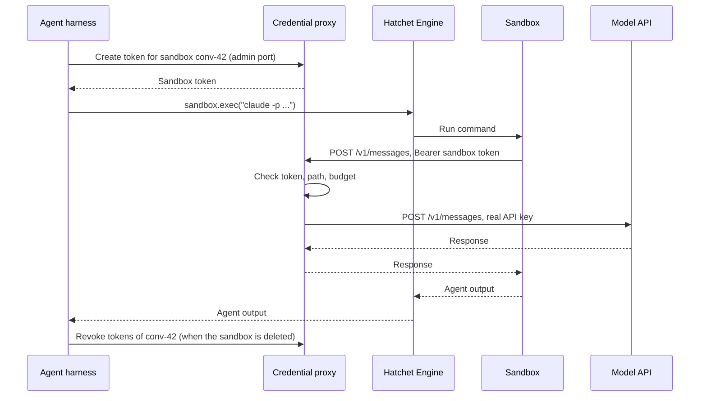

import { Callout, Steps } from "@/components/nextra-compat";

# Credentials for Sandboxed Agents

In [Agent Sandboxes](/cookbooks/agent-sandboxes), the agent loop runs in your trusted harness and only its commands run in the sandbox. The sandbox needs no credentials, because the harness holds the model API key and the worker holds the Hatchet token.

Sometimes the whole agent has to run inside the sandbox: an agent CLI such as Claude Code, an agent you did not write, or an agent whose code you want isolated from your workers. The agent then needs a model API key, and often a git or package registry token. This cookbook keeps those credentials out of the sandbox anyway.

<Callout type="warning">
  Hatchet sandboxes are in alpha and may change in future releases.
</Callout>

## The pattern

The real credentials stay in a **credential proxy** outside the sandbox. The proxy adds them to the sandbox's requests:

1. When the harness creates a sandbox, it asks the proxy for a **sandbox token**: a random string tied to that sandbox, with no value outside the proxy.
2. The agent in the sandbox calls the proxy with the sandbox token instead of the real key, for example with `ANTHROPIC_BASE_URL` pointing at the proxy.
3. The proxy checks the token, checks the request against what the sandbox may do, replaces the token with the real key, and forwards the request.
4. When the sandbox is deleted, the harness revokes its token.

The sandbox's network allows the proxy and nothing else. This is the part that makes the pattern hold: without it, a prompt-injected agent can skip the proxy and send your data anywhere.



## Why a token per sandbox is enough

You can expect the sandbox token to leak. Two things in Hatchet sandboxes make that likely:

- **Commands are task input.** Every `exec` is a Hatchet task, and its command is stored as the task's input, visible to anyone with access to the tenant. A token passed in a command is in that input.
- **Processes outside a call keep running.** A background process an earlier command started keeps running, as the same user, and can read the environment of later commands from `/proc`.

Two rules make a leaked token worthless to an attacker:

1. **The token works only from inside the sandbox network.** The proxy's model port is not reachable from anywhere else, so a copied token is useless outside.
2. **The token can do nothing the agent could not already do.** It is valid for one sandbox, until the sandbox is deleted, within that sandbox's budget, and only for the hosts and paths the proxy allows.

A stolen token gives an attacker only what the prompt-injected agent already has. So you do not need a fresh token per command, or to keep the token out of task input. Keep it out of the workspace, though: the workspace is in every snapshot and fork, and snapshots outlive a revoked token.

## Setup

<Steps>

### Run a credential proxy

The proxy runs outside the sandbox, in your own infrastructure. It needs two listeners:

- **An admin port** that only the harness can reach, to create and revoke sandbox tokens.
- **A model port** that the sandboxes can reach, to forward their requests.

Production-grade options include [LiteLLM](https://github.com/BerriAI/litellm) (virtual keys with per-key budgets), and [Envoy](https://www.envoyproxy.io/) with its `credential_injector` filter. The sketch below shows the whole contract in Node, to make it clear what the proxy must do:

```ts
import http from "node:http";
import { randomBytes } from "node:crypto";
import { Readable } from "node:stream";
import type { ReadableStream } from "node:stream/web";

const API_KEY = process.env.ANTHROPIC_API_KEY!; // only the proxy holds the real key
const UPSTREAM = "https://api.anthropic.com";
// The exact upstream paths sandboxes may call.
const ALLOWED_PATHS = new Set(["/v1/messages", "/v1/messages/count_tokens"]);
// brickie's sandbox ID format.
const SANDBOX_ID = /^[a-z0-9][a-z0-9-]{0,62}$/;

// Keep tokens in a database in production, so a restart does not bring a
// revoked token back.
const tokens = new Map<string, { sandboxId: string }>();

// Admin port: reachable by the harness only.
http
  .createServer((req, res) => {
    const url = new URL(req.url ?? "/", "http://admin");
    const sandboxId = url.searchParams.get("sandbox");
    if (url.pathname !== "/tokens") return res.writeHead(404).end();
    if (!sandboxId || !SANDBOX_ID.test(sandboxId))
      return res.writeHead(400).end();
    if (req.method === "POST") {
      const token = randomBytes(32).toString("hex");
      tokens.set(token, { sandboxId });
      return res
        .writeHead(201, { "content-type": "application/json" })
        .end(JSON.stringify({ token }));
    }
    if (req.method === "DELETE") {
      for (const [token, grant] of tokens)
        if (grant.sandboxId === sandboxId) tokens.delete(token);
      return res.writeHead(204).end();
    }
    res.writeHead(405).end();
  })
  // Loopback here; in production, an interface only the harness can reach.
  .listen(9001, "127.0.0.1");

// Model port: reachable by the sandboxes only.
http
  .createServer(async (req, res) => {
    const token = req.headers.authorization?.replace(/^Bearer /, "");
    const grant = token ? tokens.get(token) : undefined;
    if (!grant)
      return res.writeHead(401).end("unknown or revoked sandbox token");
    // Resolve the path once (this removes "..") and forward exactly that URL,
    // so a path such as /v1/messages/../models cannot reach another endpoint.
    const target = new URL(req.url ?? "/", UPSTREAM);
    if (req.method !== "POST" || !ALLOWED_PATHS.has(target.pathname))
      return res.writeHead(403).end();
    // Check the sandbox's budget here, and log the request with grant.sandboxId.

    const chunks: Buffer[] = [];
    for await (const chunk of req) chunks.push(chunk);
    const upstream = await fetch(target, {
      method: "POST",
      headers: {
        "content-type": "application/json",
        "anthropic-version": String(
          req.headers["anthropic-version"] ?? "2023-06-01",
        ),
        ...(req.headers["anthropic-beta"]
          ? { "anthropic-beta": String(req.headers["anthropic-beta"]) }
          : {}),
        "x-api-key": API_KEY,
      },
      body: Buffer.concat(chunks),
    });
    res.writeHead(upstream.status, {
      "content-type":
        upstream.headers.get("content-type") ?? "application/json",
    });
    if (upstream.body)
      Readable.fromWeb(upstream.body as ReadableStream).pipe(res);
    else res.end();
  })
  // Which networks reach this port is up to the network policy below.
  .listen(8080);
```

The sandbox talks to the proxy over plain HTTP, so the proxy can read and change the request without intercepting TLS, and the sandbox needs no extra CA certificate. Run the model port on a private network that only the sandboxes reach.

### Allow the sandboxes to reach only the proxy

Run the provider on Kubernetes with the `brickie` Helm chart from [hatchet-charts](https://github.com/hatchet-dev/hatchet-charts). Turn off all sandbox egress, then allow the proxy:

```yaml
sandbox:
  egress: none
networkPolicy:
  allowDNS: true
  egressCIDRs:
    - 10.20.30.0/28 # the proxy's addresses
```

Policies add up, so with `egress: none` the allow-list is the whole of what sandboxes may reach. Name the addresses of the proxy itself. Kubernetes does not define whether an `ipBlock` rule matches a Service's cluster IP, and network plugins differ, so do not use the Service IP. Pod IPs change when a pod is rescheduled, so give the proxy addresses that stay put, such as a dedicated subnet or node pool, or run it outside the cluster at a fixed address. NetworkPolicy is only enforced by a network plugin that implements it.

<Callout type="info">
  The Docker driver has no egress control: a Docker sandbox can reach anything
  your machine can. Use it to develop against the proxy, not to contain an
  untrusted agent.
</Callout>

### Create the sandbox and its token

Use an image that has the agent installed, for example an image built from `node:24` with `npm install -g @anthropic-ai/claude-code`. The harness creates the sandbox, gets a token for it from the proxy, and writes the agent's environment to a file in the home directory:

```ts
import { HatchetClient } from "@hatchet-dev/typescript-sdk/v1";
import "@hatchet-dev/sandbox";

const hatchet = HatchetClient.init();
const PROXY_ADMIN = "http://credential-proxy-admin:9001";
const PROXY_URL = "http://credential-proxy:8080"; // as the sandbox reaches it

export async function startAgentSandbox(conversationId: string) {
  const sandbox = await hatchet.sandbox.create({
    id: `conv-${conversationId}`,
    template: "registry.example.com/agent-claude-code:1",
    metadata: { conversation: conversationId },
  });

  const res = await fetch(
    `${PROXY_ADMIN}/tokens?sandbox=${sandbox.sandboxId}`,
    { method: "POST" },
  );
  const { token } = (await res.json()) as { token: string };

  // The home directory is not part of snapshots, so the token never reaches the
  // snapshot store or a fork. It is lost when the sandbox is started again from
  // a snapshot: write a new one after every connect that restarted it.
  const env = [
    `export ANTHROPIC_BASE_URL=${PROXY_URL}`,
    `export ANTHROPIC_AUTH_TOKEN=${token}`,
    "export CLAUDE_CODE_DISABLE_NONESSENTIAL_TRAFFIC=1",
    "export CLAUDE_CONFIG_DIR=/workspace/.claude",
  ].join("\n");
  await sandbox.exec(
    `umask 077 && cat > "$HOME/.agent-env" <<'EOF'\n${env}\nEOF`,
  );

  return sandbox;
}
```

- `ANTHROPIC_AUTH_TOKEN` makes Claude Code send the sandbox token as a bearer token. Do not set `ANTHROPIC_API_KEY` in the sandbox.
- `CLAUDE_CODE_DISABLE_NONESSENTIAL_TRAFFIC` stops Claude Code from calling hosts other than the model API, which the egress rules block anyway.
- `CLAUDE_CONFIG_DIR=/workspace/.claude` keeps Claude Code's sessions in the workspace, so `--resume` works after the sandbox is started again from a snapshot. The workspace is in every snapshot, so never run `claude login` or `/login` in the sandbox: it writes a credential file to this directory.

### Run the agent

Each turn of the agent is one `exec`. Load the environment file in the same command:

```ts
const shellQuote = (s: string) => `'${s.replaceAll("'", `'\\''`)}'`;

const result = await sandbox.exec(
  `. "$HOME/.agent-env" && claude -p ${shellQuote(prompt)} --output-format json`,
  { timeoutMs: 15 * 60 * 1000 },
);
const { result: answer, session_id } = JSON.parse(result.stdout);
```

Pass `--resume <session_id>` on the next turn to continue the same conversation. The command's output arrives when the command ends, so set `timeoutMs` to the longest turn you allow. A turn that runs past it is killed and returns exit code 124.

### Proxy git and package registries the same way

Point git and npm at the proxy over plain HTTP, and let the proxy add the GitHub or registry token for the repositories and packages this sandbox may use:

```bash
git -c url."http://credential-proxy:8080/github/".insteadOf=https://github.com/ \
  clone https://github.com/acme/app.git
npm install --registry=http://credential-proxy:8080/npm/
```

Pass the settings on the command line or through the environment file, not in `.gitconfig` or `.npmrc` in the workspace.

For powerful operations, such as a deploy or a database write, do not proxy the credential at all. Give the agent a tool that runs outside the sandbox, such as a Hatchet task exposed as described in [Hatchet Agent Tools](/cookbooks/hatchet-and-mcp), and check each call there.

### Revoke the token with the sandbox

Revoke the sandbox's tokens when you delete it:

```ts
await hatchet.sandbox.delete({ sandboxId: sandbox.sandboxId });
await fetch(`${PROXY_ADMIN}/tokens?sandbox=${sandbox.sandboxId}`, {
  method: "DELETE",
});
```

A sandbox that idles out stops but is not deleted, and `connect` can start it again. Keep its token until you delete the sandbox, or revoke it when the sandbox stops and create a new one after the next `connect`.

</Steps>

## Check that it holds

Test these from inside a sandbox before you trust the setup:

1. **The token works through the proxy.** The agent's first model call succeeds.
2. **Nothing else is reachable.** A direct connection to the model API's address fails, while a connection to the proxy succeeds. Connect by IP address, so a DNS failure cannot pass for a blocked connection.
3. **A revoked token is dead.** After you revoke it, the proxy answers `401` to the same token.
4. **Sandboxes are separate.** A second sandbox gets its own token, and its token cannot be used for the first sandbox's budget.
5. **No credential is stored.** No real key appears in task inputs in the Hatchet dashboard, and no token appears in a snapshot.

## Limits of this pattern

- **The agent can still misuse what it is allowed.** The proxy limits where requests go and how much they cost, not what is in them. An agent can put workspace contents into a model request or a git push it is allowed to make. Allow only the hosts, paths and repositories the sandbox needs.
- **Leftover processes.** A process left by an earlier command can use the current token for as long as the sandbox runs. Revocation and the two rules above bound what that gives an attacker.
- **The admin port must be out of reach.** If a sandbox can reach the admin port, it can create tokens. Put it on a listener and network the sandboxes cannot reach, not behind a password on the same port.
- **Revocations must persist.** A proxy that keeps revocations in memory forgets them when it restarts.

## Next steps

- [Agent Sandboxes](/cookbooks/agent-sandboxes): the basics of Hatchet sandboxes.
- [Durable Coding Agent with pi-durable](/cookbooks/pi-durable-coding-agent): a coding agent whose loop runs in the harness and whose tools run in sandboxes, so the sandbox needs no credentials.
- [Securely deploying AI agents](https://code.claude.com/docs/en/agent-sdk/secure-deployment): Anthropic's guide to isolation and credential management for agents.
