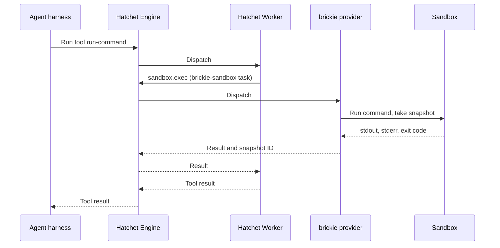

import { Callout, Steps } from "@/components/nextra-compat";

# Running Agent Commands in Hatchet Sandboxes

The [Claude Agent SDK](/cookbooks/hatchet-claude-agent-sdk-trusted-env) and [OpenAI Agents SDK](/cookbooks/hatchet-openai-agents-sdk-trusted-env) cookbooks give an agent tools that run as Hatchet tasks on your own workers. That works when every tool is code you wrote. A coding agent needs more: it writes files and runs commands that the model chooses. Those commands should not run on your worker, next to your credentials.

This cookbook gives an agent a shell in a **Hatchet sandbox**. The agent loop and its API keys stay in your trusted harness. Only the commands run in the sandbox.

<Callout type="warning">
  Hatchet sandboxes are in alpha and may change in future releases. The
  TypeScript SDK is `@hatchet-dev/sandbox`.
</Callout>

## What a sandbox is

A sandbox is a workspace with a shell, running in a container.

- **Each call is a Hatchet task.** `exec`, `files.read`, `files.write` and the other calls each run as one `brickie-sandbox` task, so every command the agent runs shows up in the dashboard with its input, output and timing.
- **Each call that changes files takes a snapshot.** You can start a new sandbox from any snapshot. Two sandboxes started from the same snapshot are a fork.
- **A sandbox can be continued by its ID.** If it stopped (it was idle, or its provider restarted), `connect` starts it again from its latest snapshot.
- **Inside a durable task, each call is a durable step.** After a crash, the task replays the calls it already made instead of running them again.

Sandboxes are run by **brickie**, a sandbox provider that connects to your tenant as a Hatchet operator. Your application only talks to Hatchet. It never talks to brickie or to a sandbox directly.

## Architecture



## Setup

<Steps>

### Prepare your environment

You need:

- A Hatchet tenant. On [Hatchet Cloud](https://cloud.hatchet.run), or a self-hosted Hatchet v0.110.0 or newer with gRPC operators turned on (`SERVER_GRPC_OPERATORS_ENABLED=true`).
- Docker, to run sandboxes on your machine.
- The brickie provider binary, `brickie`, from [github.com/hatchet-dev/brickie](https://github.com/hatchet-dev/brickie).
- A TypeScript Hatchet project (see the [Quickstart](/v1/quickstart)) with `@hatchet-dev/typescript-sdk` 1.33.1 or newer.

Install the sandbox SDK:

```bash
npm install @hatchet-dev/sandbox zod@^4.0.0
```

### Start the provider

Start brickie with a token for your tenant. On a laptop it runs each sandbox as a container on the local Docker engine and keeps snapshots in a local folder:

```bash
HATCHET_CLIENT_TOKEN=<your tenant token> brickie worker
```

Leave it running. It registers the `brickie-sandbox` task with your tenant, so sandbox calls from any client in the tenant reach it.

<Callout type="info">
  A Docker sandbox is a plain container, not a VM. It is good for development
  and CI. For agents you do not trust, run the provider on Kubernetes with the
  Kata or gVisor runtime, as described in the{" "}
  <a href="#isolation">isolation section</a> below.
</Callout>

### Create a sandbox for each conversation

Import `@hatchet-dev/sandbox` once. It adds `hatchet.sandbox` to the Hatchet client.

Create one sandbox per conversation, with an ID you can find again. `template` is the container image the sandbox runs. Here, the harness seeds the workspace with a small repository before the agent starts:

```ts
import { HatchetClient } from "@hatchet-dev/typescript-sdk/v1";
import "@hatchet-dev/sandbox";

export const hatchet = HatchetClient.init();
export const IMAGE = "node:24-alpine";

export async function createWorkspace(conversationId: string) {
  const sandbox = await hatchet.sandbox.create({
    id: `conv-${conversationId}`,
    template: IMAGE,
    metadata: { conversation: conversationId },
    idleTimeoutMs: 30 * 60 * 1000,
  });

  await sandbox.files.write([
    {
      path: "package.json",
      data: JSON.stringify({
        type: "module",
        scripts: { test: "node --test" },
      }),
    },
    { path: "sum.js", data: "export const sum = (a, b) => a - b;\n" },
    {
      path: "sum.test.js",
      data: [
        "import { test } from 'node:test';",
        "import assert from 'node:assert';",
        "import { sum } from './sum.js';",
        "test('sum', () => assert.strictEqual(sum(2, 3), 5));",
        "",
      ].join("\n"),
    },
  ]);

  return sandbox.sandboxId;
}
```

A sandbox ID uses lowercase letters, digits and hyphens, starts with a letter or digit, and is at most 63 characters long. `create` with an ID that already exists throws: use `connect` to continue a sandbox.

### Define the sandbox tool

Define a Hatchet task that runs one command in a conversation's sandbox. The task connects to the sandbox by ID, so any worker can run it, and the sandbox is started again from its snapshot if it stopped. Pass the same `template` to `connect` as to `create`: the provider does not store the image, and a stopped sandbox started without it comes back on the provider's default image.

```ts
import { z } from "zod/v4";
import { hatchet, IMAGE } from "./client";

const RunCommandInput = z.object({
  sandboxId: z.string(),
  command: z.string(),
});

export const runCommand = hatchet.task({
  name: "run-command",
  inputValidator: RunCommandInput,
  description:
    "Run a shell command in the workspace of the current conversation and return its output. " +
    "The workspace is /workspace.",
  fn: async (input: z.infer<typeof RunCommandInput>) => {
    const sandbox = await hatchet.sandbox.connect(input.sandboxId, {
      template: IMAGE,
    });
    const result = await sandbox.exec(input.command, { timeoutMs: 120_000 });
    return {
      exitCode: result.exitCode,
      stdout: result.stdout,
      stderr: result.stderr,
      snapshotId: result.snapshotId,
    };
  },
});
```

A command that fails does not throw: the agent gets its exit code and output, the same as in a terminal. A command that runs past `timeoutMs` is killed and returns exit code 124.

Register `runCommand` with a worker, as in the <a href="/cookbooks/hatchet-claude-agent-sdk-trusted-env#register-and-start-the-worker">Claude Agent SDK cookbook</a>.

### Give the tool to the agent

The model chooses the command, but never the sandbox. If the sandbox ID were a tool argument, a prompt-injected agent could name another conversation's sandbox, and the task, which runs on a worker without the conversation's context, could not tell. So define the agent's tool in the harness, with the conversation's sandbox ID fixed in it, and let the model send only the command:

```ts
import { tool } from "@anthropic-ai/claude-agent-sdk";
import { z } from "zod/v4";
import { runCommand } from "./tools";

// One tool per conversation, bound to that conversation's sandbox.
export function shellTool(sandboxId: string) {
  return tool(
    "run_command",
    "Run a shell command in /workspace and return its exit code and output.",
    { command: z.string() },
    async ({ command }) => {
      const result = await runCommand.run({ sandboxId, command });
      return { content: [{ type: "text", text: JSON.stringify(result) }] };
    },
  );
}
```

Put the tool in the conversation's in-process MCP server, as in the <a href="/cookbooks/hatchet-claude-agent-sdk-trusted-env#wire-the-claude-agent-sdk">Claude Agent SDK cookbook</a>. With the OpenAI Agents SDK, build it the same way with `tool({ name, description, parameters, execute })` from `@openai/agents`. Each call still runs as a `run-command` task, so it shows up in the dashboard like any other tool call.

### Branch and clean up

Every call that changes files returns a `snapshotId`. To let the agent try something risky, start a new sandbox from the snapshot before it, and drop it if the attempt fails:

```ts
const branch = await hatchet.sandbox.create({
  from: snapshotId,
  template: "node:24-alpine",
  inheritParentMetadata: true,
});
```

When the conversation pauses, `sandbox.kill()` stops its sandbox and keeps its snapshots, so `connect` can bring it back later. When the conversation is over, delete its sandboxes with every snapshot and file stored for them:

```ts
await hatchet.sandbox.delete({ metadata: { conversation: conversationId } });
```

The metadata filter matches the conversation's sandbox and its forks, because `inheritParentMetadata` copied the tag onto them.

<Callout type="info">
  `delete` and `inheritParentMetadata` need `@hatchet-dev/sandbox` 0.1.1 and
  brickie 0.1.3 or newer.
</Callout>

</Steps>

## What to know about sandboxes

- **Only the workspace is kept.** A snapshot is a tar of `/workspace`. Files elsewhere, such as the home directory, survive between calls on a running sandbox, but are gone when the sandbox is started again from a snapshot. Anything written to `/workspace` is in every later snapshot and every fork, so never write credentials there.
- **Processes outside a call keep running.** A command that starts a background process (`cmd &`, `nohup`, `setsid`) leaves it running after the call returns, and later calls can see it. Treat everything that ran in a sandbox earlier as able to read what runs in it later.
- **Output arrives when the command ends.** `exec` returns stdout and stderr together, up to 1 MiB each.
- **One call at a time.** The provider runs the calls on one sandbox one after another.
- **Files without network.** `files.download` and `files.upload` move files between the workspace and an https URL. The provider does the transfer, so the sandbox needs no network for it.

## Isolation

The sandbox is the agent's attack surface: everything it can reach, a prompt-injected agent can reach.

- **Docker** (`--driver docker`, the default): a container on the local engine, with normal Docker networking. Use it for development and CI, not for untrusted agents.
- **Kubernetes** (`--driver kubernetes`, or the `brickie` Helm chart from [hatchet-charts](https://github.com/hatchet-dev/hatchet-charts)): each sandbox is an [agent-sandbox](https://github.com/kubernetes-sigs/agent-sandbox) claim on a pre-started pod. The pod runs under gVisor or Kata Containers when the cluster has the runtime class (the `brickie` binary defaults to `--runtime auto`, which falls back to the default runtime with a warning; the Helm chart defaults to `sandbox.runtime: kata`; set `gvisor` or `kata` to require one). The pod has no service account token, no privilege escalation, and the runtime default seccomp profile. Linux capabilities are not dropped, because package managers in common images need them: the runtime class is the isolation layer. Without Kata or gVisor, a sandbox is a plain container on the node, so do not run untrusted agents there.
- **Egress** (`--sandbox-egress`, Kubernetes only): `internet` allows public addresses and cluster DNS and blocks private ranges and the cloud metadata endpoint. `none` allows nothing. The Helm chart's `networkPolicy.egressCIDRs` adds an allow-list on top, so `none` with an allow-list lets sandboxes reach only the addresses you name. NetworkPolicy is only enforced by a CNI that implements it.

The sandbox never holds your Hatchet token or your model API key: the harness and the worker hold them. If the agent's commands need credentials of their own, for example to push to git or call the model API from inside the sandbox, see [Credentials for Sandboxed Agents](/cookbooks/agent-sandbox-credentials).

## Next steps

- [Credentials for Sandboxed Agents](/cookbooks/agent-sandbox-credentials): run a whole agent inside the sandbox, with its credentials kept in a proxy outside.
- [Durable Coding Agent with pi-durable](/cookbooks/pi-durable-coding-agent): a complete coding agent that survives worker crashes, with a sandbox for every conversation.
- [Hatchet Agent Tools](/cookbooks/hatchet-and-mcp): exposing tasks and workflows as agent tools.
