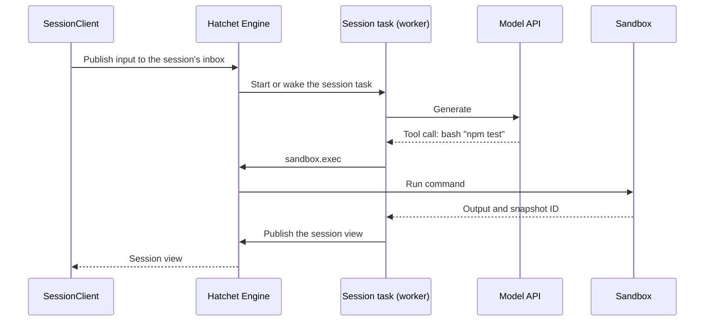

import { Callout, Steps } from "@/components/nextra-compat";

# Durable Coding Agent with pi-durable

[pi-durable](https://www.npmjs.com/package/@earendil-works/pi-durable) is an agent harness that keeps an agent's state durable: its conversations, the tool calls in progress, forks, and documents all survive a crash. `@hatchet-dev/pi-durable` runs it on Hatchet, and gives it the rest of what a production coding agent needs:

- **One owner per session.** Each session is owned by one run of a Hatchet task. If its worker dies, Hatchet retries the run on another worker, and the agent resumes from its storage.
- **A sandbox per conversation.** The agent's read, write, edit and bash tools run in a [Hatchet sandbox](/cookbooks/agent-sandboxes), not on the worker. A fork of a conversation gets its own sandbox, started from the snapshot taken at the fork point.
- **A way in and out.** A client sends messages to a session and reads its live state from anywhere (a web server, a CLI, another task) over [durable streams](/v1/durable-streams).

The agent loop and its model API key stay on your worker. Only the tool calls run in the sandbox, so the sandbox needs no credentials.

<Callout type="warning">
  pi-durable, Hatchet sandboxes and durable streams are experimental or in alpha
  and may change in future releases. `@hatchet-dev/pi-durable` pins pi-durable
  to `~1.5.0`, because a minor release of pi-durable can change its storage
  format or API.
</Callout>

## Architecture



- **The session task** owns the session. Its concurrency key is the session ID, with one run at a time, so a session never has two owners. When the session is idle for a while, the task returns, and the next message starts a new run.
- **The inbox** is a durable stream topic the client publishes to. Each message carries a request ID, so a message delivered twice is applied once.
- **The view** is a durable stream topic the session task publishes its state to after every change. A client that connects starts at the newest view.

## Setup

<Steps>

### Prepare your environment

You need:

- A Hatchet tenant with durable streams turned on (<a href="mailto:support@hatchet.run">contact us</a> to enable them), and with a sandbox provider connected, as described in [Agent Sandboxes](/cookbooks/agent-sandboxes#start-the-provider).
- Node 22.9 or newer, and `@hatchet-dev/typescript-sdk` 1.44.0 or newer.
- An `ANTHROPIC_API_KEY` environment variable on the worker.

Install the packages:

```bash
npm install @hatchet-dev/pi-durable @hatchet-dev/typescript-sdk @hatchet-dev/sandbox \
  @earendil-works/pi-durable@~1.5.0 @earendil-works/pi-ai@~1.5.0 @earendil-works/chord@~1.5.0
```

### Set up the agent

Create the model registry and install the sandbox coding tools. `sandboxCoding()` gives the agent pi's read, write, edit and bash tools. The tools that can change the workspace record its snapshot after they run:

```ts
import { createModels } from "@earendil-works/pi-ai/models";
import { anthropicProvider } from "@earendil-works/pi-ai/providers/anthropic";
import { createRegistry } from "@earendil-works/pi-durable";
import { sandboxCoding } from "@hatchet-dev/pi-durable";
import { HatchetClient } from "@hatchet-dev/typescript-sdk/v1";

export const hatchet = HatchetClient.init();

export const models = createModels();
models.setProvider(anthropicProvider());

export const registry = createRegistry();
registry.install(
  sandboxCoding({
    instructions:
      "The repository is in /workspace. Run its tests with npm test.",
  }),
);
```

### Define the session task

`defineSessionTask` makes the Hatchet task that owns a session. `openHarness` opens the session's pi-durable harness on its storage, with `sandboxEnvs()` as the environment, so each tool call runs in the sandbox of its conversation:

```ts
import { Harness } from "@earendil-works/pi-durable";
import { openNodeSqliteStorage } from "@earendil-works/pi-durable/storage/sqlite/node";
import { defineSessionTask, sandboxEnvs } from "@hatchet-dev/pi-durable";
import { hatchet, models, registry } from "./agent";

const TEMPLATE = "node:24"; // includes git

export const session = defineSessionTask(hatchet, {
  agent: {
    model: { provider: "anthropic", modelId: "claude-opus-5-5" },
    cwd: "/workspace",
  },
  sandbox: {
    template: TEMPLATE,
    // Fill each conversation's first sandbox, for example with a repository.
    seed: async (sandbox) => {
      await sandbox.exec(
        "git clone --depth 1 https://github.com/acme/app.git .",
      );
    },
  },
  maxSessionCostUsd: 3,
  openHarness: async (sessionId, onReport, context) =>
    Harness.open(
      await openNodeSqliteStorage(`.pi-data/${sessionId}.sqlite`),
      {
        models,
        registry,
        env: sandboxEnvs(hatchet, { template: TEMPLATE }),
        onReport,
      },
      context,
    ),
});
```

`maxSessionCostUsd` aborts every conversation of the session once it has spent that much.

<Callout type="info">
  The session task does not store anything itself: failover reaches as far as
  the storage you open in `openHarness`. SQLite on the worker's disk only fails
  over to a worker on the same machine, or one with the same volume. pi-durable
  has no cross-process locking, so there must be one owner at a time, which the
  task's concurrency provides.
</Callout>

### Start the worker

Register the session task with a worker:

```ts
import { hatchet } from "./agent";
import { session } from "./session";

const worker = await hatchet.worker("pi-worker", { workflows: [session] });
await worker.start();
```

Start two workers to see failover.

### Talk to a session

`SessionClient` creates sessions, sends them messages and reads their views. It needs only a Hatchet client, so a web server or a CLI can use it:

```ts
import { SessionClient } from "@hatchet-dev/pi-durable";
import { hatchet } from "./agent";

const sessions = new SessionClient(hatchet);
const sessionId = await sessions.create();

// A session starts with one conversation, the root, whose ID is 1.
await sessions.send(sessionId, {
  type: "input",
  conversationId: 1,
  text: "Fix the failing test.",
});

for await (const view of sessions.views(sessionId)) {
  const root = view.conversations.find((c) => c.id === 1);
  console.log(root?.items.at(-1));
}
```

`send` takes one of these messages:

| Message                                              | Effect                                                                                                                                                                         |
| ---------------------------------------------------- | ------------------------------------------------------------------------------------------------------------------------------------------------------------------------------ |
| `{ type: 'input', conversationId, text, whenBusy? }` | Adds a user message. A busy conversation gets it after its current run (the default), or during it with `whenBusy: 'steer'`. A conversation's first input creates its sandbox. |
| `{ type: 'fork', conversationId, entryId }`          | Starts a new conversation from that entry, with a sandbox started from the snapshot of that point.                                                                             |
| `{ type: 'abort', conversationId }`                  | Stops the conversation's current run.                                                                                                                                          |

A message the session cannot apply, such as an input for a conversation that does not exist, is not dropped: the view's `rejected` list has it, with the reason.

### Test failover

Send a task that takes a while, such as "Fix the failing test", and stop the worker that owns the session while a command is running. The view shows the run's attempt. Within a few seconds, Hatchet retries the session task on the other worker, which resumes the session from its storage: the agent carries on from the tool call it was in, in the same sandbox.

</Steps>

## What the view contains

The session task publishes a `SessionView` after every change:

- the run and attempt that owns the session;
- for each conversation: its items, its live generation and tool output, its sandbox and latest snapshot, its token usage and cost, and why its last run failed, if it did;
- the last 20 messages the session rejected.

A conversation's items are a window of its newest 50 to 100 entries. `before` is the ID of the entry just before the window, and is absent when the window starts at the beginning of the conversation.

## Options

| Option                  | Default      |                                                                                                           |
| ----------------------- | ------------ | --------------------------------------------------------------------------------------------------------- |
| `name`                  | `pi-session` | The task's name, and the prefix of the session's stream topics. Give `SessionClient` the same `taskName`. |
| `sandbox.workspace`     | `/workspace` | The sandbox's workspace. Tool paths outside it are refused.                                               |
| `sandbox.idleTimeoutMs` | 30 min       | A sandbox with no calls for this long stops. The next call starts it again from its snapshot.             |
| `idleGraceMs`           | 20 s         | How long an idle session task waits for the next message before it returns.                               |
| `retries`               | 3            | Retries of the session task after a crash.                                                                |
| `executionTimeout`      | `60m`        | The longest one run may own the session.                                                                  |

## How tools behave in a sandbox

- A command's output arrives when the command ends, not while it runs.
- Aborting a conversation cancels its sandbox run, and the provider kills the command.
- A sandbox runs one call at a time.

## Next steps

- [Agent Sandboxes](/cookbooks/agent-sandboxes): how Hatchet sandboxes work, and how to isolate them.
- [Credentials for Sandboxed Agents](/cookbooks/agent-sandbox-credentials): when the agent itself has to run in the sandbox.
- [Durable Streams](/v1/durable-streams): the streams the session's inbox and view use.
