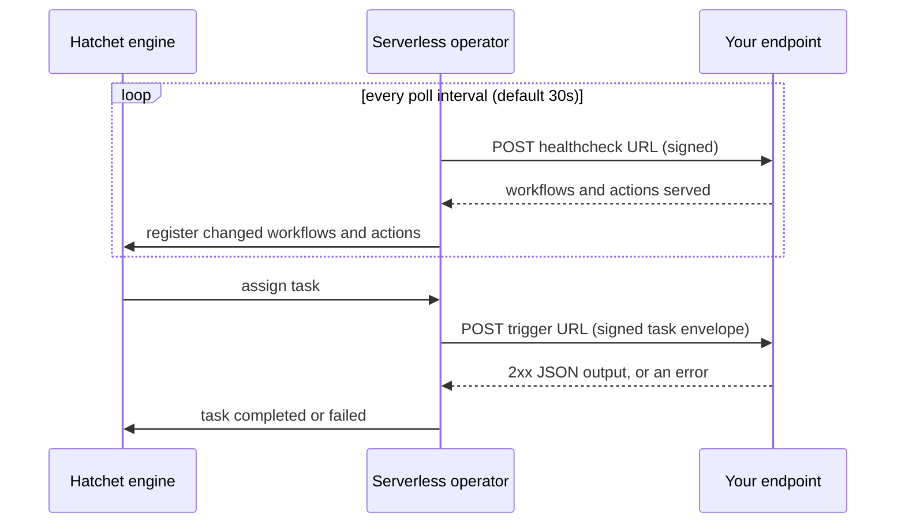

import { Callout } from "@/components/nextra-compat";

# Serverless Endpoints

A serverless endpoint lets Hatchet run your tasks by calling an HTTPS function you deploy in serverless or edge environments, instead of you running a long-lived [worker](/v1/workers). After registering the endpoint with Hatchet, Hatchet will discover the workflows the endpoint serves and deliver each task to the endpoint as a signed HTTPS request. See the guides for setup instructions:

- [Cloudflare Workers](/v1/serverless/cloudflare-workers): deploy an endpoint as a Cloudflare Worker
- [Vercel](/v1/serverless/vercel): deploy an endpoint as a Vercel function via a Next.js route
- [HTTP contract](/v1/serverless/http): deploy any generic HTTP(s) destination as an endpoint
- [Managing endpoints](/v1/serverless/managing-endpoints): create, update and delete endpoints from the dashboard, the REST API or an SDK
- [Troubleshooting](/v1/serverless/troubleshooting): investigate endpoint statuses, healthchecks, and delivery failures

<Callout type="warning">
  Serverless endpoints must be enabled for your tenant. Until they are, creating
  an endpoint fails with `403` and the message `the serverless operator is not
  enabled for this tenant`.
</Callout>

## How it works

Each endpoint is registered with the following information:

- The **healthcheck URL**, which the operator polls to learn which workflows the endpoint serves.
- The **trigger URL**, which receives each task the engine assigns to the endpoint.
- The **signing secret** (at least 32 characters), which the operator uses to sign every request. Your endpoint verifies the signature before doing any work.

1. **Discovery.** Hatchet sends a signed `POST` to the healthcheck URL every poll interval, 30 seconds by default. The endpoint responds with the list of workflows which are able to run on that endpoint.
2. **Delivery.** when a task is sent to Hatchet, the Hatchet engine will send a signed `POST` to the trigger URL with the task's input. The endpoint returns with the task's output.
3. **Health.** Three consecutive failed healthchecks cause the endpoint to enter an unhealthy state. If no endpoint corresponding to a task or workflow is healthy, the Hatchet engine will still attempt to deliver to unhealthy endpoints.

Every request carries `X-Hatchet-Signature` (the hex HMAC-SHA256 of the raw body under the signing secret), `X-Hatchet-Timestamp` and `X-Hatchet-Endpoint-Id`.

## Endpoints or workers?

|                       | Serverless endpoint                                                    | Worker                                                                       |
| --------------------- | ---------------------------------------------------------------------- | ---------------------------------------------------------------------------- |
| What you run          | An HTTPS function on any platform that serves public HTTPS on port 443 | A long-lived process (typically a container) holding a connection to Hatchet |
| Scaling               | The platform scales invocations, and you pay per request               | You run and scale the processes yourself                                     |
| Task duration         | Capped by the endpoint's request timeout and the platform's own limit  | No limit beyond the task's own timeout                                       |
| Durable tasks         | Yes (see limitations)                                                  | Yes                                                                          |
| Network access needed | Hatchet must reach the endpoint over public HTTPS                      | The worker connects out to Hatchet                                           |

Use an endpoint when your code already runs on a serverless platform, when tasks are short and bursty, or when you don't want to operate worker processes. Use a [worker](/v1/workers) for long-running or durable tasks, for heavy local state, or when your code can't be exposed on a public HTTPS URL.

## Limitations

- **HTTPS on port 443 at a public address.** URLs must use `https`, must not include credentials, and may only name port 443. Hatchet refuses loopback and private network destinations, and doesn't follow redirects. For local development, put a public HTTPS tunnel in front of your endpoint.
- **Request timeout.** Each trigger request is bounded by the endpoint's request timeout: 60 seconds by default and 600 seconds at most. A timed-out request fails the task as retryable. Your platform's own maximum invocation duration still applies.
- **Response size.** A trigger response body over 4 MiB fails the task without a retry.
- **Catalog size.** By default one healthcheck may declare at most 200 workflows and 500 actions.
- **Durable tasks.** An endpoint can only serve durable tasks if the underlying platform supports websockets.
