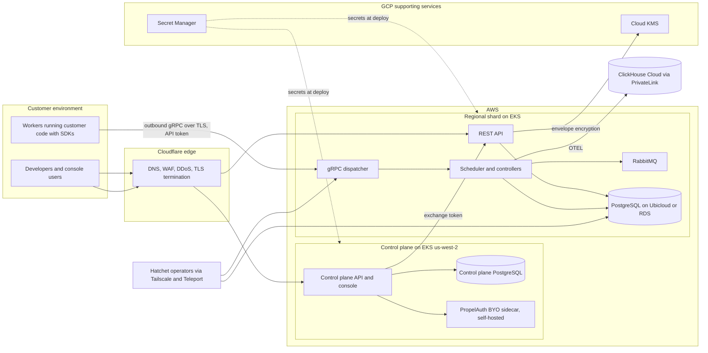

# Company Background

Hatchet Technologies, Inc. ("Hatchet") builds a platform for running mission-critical AI agents, durable workflows, and background tasks. Every task and agent invocation is persisted, so work survives crashes and can be retried, replayed, and debugged. Customers define tasks as code in Python, TypeScript, Go, or Ruby. Workers running in the customer's environment connect to the engine over gRPC. The console and API provide monitoring, alerting, and logging.

The platform is open source under the MIT license. The same core engine code performs task orchestration in Hatchet Cloud and in self-hosted deployments. Hatchet Cloud adds the managed control plane, multi-tenant operations, and hosted infrastructure. Hatchet Cloud is the system under examination. This description covers Hatchet Cloud for the period July 28, 2026 to October 28, 2026.

Hatchet Cloud processes billions of tasks per month. Hundreds of companies run production workloads on Hatchet Cloud. The open-source project is deployed more than 10,000 times per month. Customers are engineering teams worldwide. Data-plane regions run in the United States, the European Union, and Australia, and EU customers can keep tenant data in the EU region.

Hatchet processes standard personal information (names, emails, addresses), protected health information (PHI) under HIPAA as a Business Associate, and personal data of EU residents subject to the General Data Protection Regulation (GDPR). Hatchet maintains compliance with SOC 2 (Security), HIPAA, and GDPR, and publishes its compliance posture at its Trust Center (trust.hatchet.run).

The CTO is the designated Security Official. The Security Official develops, implements, and oversees the information security program.

# Services Provided

Hatchet Cloud is a managed orchestration platform for background tasks, durable workflows, and AI agents. It is a durable execution engine. Each task invocation is persisted, which supports automatic retries, replays, debugging, and workflow patterns that a traditional queue does not.

Platform capabilities include configurable retry policies (including exponential backoff), cron scheduling, and future-dated execution. Multi-step durable workflows checkpoint state to a durable event log and survive crashes without losing progress. AI agent execution supports human-in-the-loop waits and real-time streaming. The engine provides concurrency control, rate limiting, task priority, and worker affinity routing, plus real-time monitoring, alerting, and logging.

Customers integrate by defining tasks as functions in their application code and connecting workers to the engine over gRPC. Native SDKs cover Python, TypeScript, Go, and Ruby. Customers use the web console at cloud.hatchet.run, the REST API, and the gRPC API.

Hatchet Cloud runs data-plane regions on Amazon Web Services in the United States (Oregon and Northern Virginia), the European Union (Ireland), and Australia (Sydney). Customers on custom plans can add dedicated capacity, additional regions, or bring-your-own-cloud deployments. Customer workloads include data pipelines, AI agent loops, video encoding, GPU scheduling, and event-driven systems.

# Service Commitments and System Requirements

Hatchet commits to customers on the security of Hatchet Cloud. Those commitments are in the Cloud Service Agreement (Terms and Conditions, published at hatchet.run/policies/terms), the Privacy Policy (hatchet.run/policies/privacy), the Data Processing Agreement (hatchet.run/policies/dpa), and the Trust Center (trust.hatchet.run). The Cloud Service Agreement states that Hatchet will use commercially reasonable efforts to secure the Cloud Service from unauthorized access, alteration, or use and other unlawful tampering.

Hatchet sets internal system requirements from the Trust Services Criteria for Security, the only category in scope. Those requirements are the control objectives below. Later sections describe how they are implemented.

**Security** commitments include the following:

- Encrypt all data in transit using TLS (minimum TLS 1.2) for API and worker traffic, and encrypt all data at rest on production storage and database services using encryption provided by the underlying infrastructure.
- Enforce logical tenant isolation so that every request is authenticated and scoped to a single tenant.
- Restrict access to production infrastructure and customer data to authorized personnel on a least-privilege basis, and require multi-factor authentication for administrative, infrastructure, and critical-service access.
- Deploy a web application firewall and DDoS mitigation at the network edge.
- Run vulnerability scans across infrastructure, applications, and dependencies, and perform independent third-party penetration testing at least annually. Remediate findings on severity-based timelines.
- Maintain an incident response framework covering detection, containment, eradication, recovery, and breach notification, including HIPAA notification to covered entities within required timeframes.
- Manage infrastructure and configuration changes through infrastructure-as-code and version-controlled code review, with segregation of duties between change authors and approvers.
- Review access at least annually, revoke access on termination, and disable dormant accounts.
- Assess third-party vendors before granting access to production environments or customer data, and keep an inventory of vendors by data sensitivity and risk.
- Publish security commitments and service descriptions through the Trust Center, Terms and Conditions, and Privacy Policy.

**System requirements.** The following requirements are how those commitments are met. Each one is implemented by a procedure described later in this section.

- Every user and service account has a unique identity. Hatchet uses Google Workspace single sign-on where the service supports it, and requires multi-factor authentication on critical systems. Access is least privilege. A manager and the Security Official approve grants. Unused accounts are removed within 30 days. Access is revoked within 24 hours of departure. Access is reviewed at least annually. (Access Management Policy v3.1)
- Production access uses short-lived, audited privileged-access credentials issued by Teleport. Personnel do not hold standing production credentials. (Access Management Policy v3.1)
- Production and infrastructure changes go through version control and an independent review. Emergency changes are documented within one business day. (Change Management Policy v2.1)
- Production customer data has nightly encrypted backups retained at least three days, point-in-time recovery where the database supports it, an annual restore test, and documented recovery time and recovery point objectives. (Data Backup and Recovery Policy v2.0; Business Continuity and Disaster Recovery Policy v2.0)
- Vulnerability remediation targets are 7 days for critical (P0), 30 days for high (P1), 60 days for medium (P2), and as needed for low (P3). An independent firm performs a penetration test at least annually. (Vulnerability Management Policy v3.0)
- Audit logs cover authentication, administrative actions, privilege changes, and lifecycle events. Logs are sent to a central store and protected from tampering. Security logs are retained for one to five years. PHI access logs are retained for six years. (Audit Log Management Policy v3.0; Data Management, Retention, and Destruction Policy v4.1)
- Employees complete security awareness training within 30 days of start and annually after that, plus HIPAA and GDPR training where the role requires it. (Human Resource Security Policy v2.0)
- A vendor risk review is completed before a vendor connects to production. Vendors that handle sensitive data must provide a SOC 2 or ISO 27001 report, or an equivalent. The vendor inventory is reviewed annually. (Vendor Management Policy v2.0)
- Workstations use disk encryption, a host firewall, a screen lock at 20 minutes, and anti-malware. PHI is not stored on local drives. (Workstation Security Policy v3.0)

# Components of the System

The system is the infrastructure, software, people, data, and procedures Hatchet uses to deliver Hatchet Cloud and meet its security commitments.

The system is comprised of the following components:

- **Infrastructure.** The physical and virtual resources that support the environment, including cloud facilities, servers, storage, data storage devices, and the networks that connect them. Hatchet does not operate its own data centers.
- **Software.** The application programs and supporting system software, including the in-house platform, databases, and the external-facing web application. There is no native mobile application.
- **People.** The personnel involved in governance, operation, security, and use of the system, including developers, operators, managers, contractors, and vendor personnel. Customer personnel use the service but do not operate it.
- **Data.** The data the system uses and stores, including workflow and execution data, observability data, account metadata, and audit logs.
- **Procedures.** The automated and manual procedures by which the service is authorized, performed, and delivered, and by which security controls are operated.

## Architecture and Data Flow

Hatchet Cloud has two tiers. Both run on Amazon Web Services.

The control plane runs on the production Amazon EKS cluster in us-west-2 (Oregon). It handles sign-up, organizations, tenant provisioning, and billing hooks. Console login (email and password, Google, GitHub, and enterprise SSO) is handled by PropelAuth BYO, which Hatchet runs as a self-hosted sidecar next to the control-plane API, with its own PostgreSQL database. Customer identity data stays in Hatchet's infrastructure. The control plane issues short-lived exchange tokens that the console uses to call a shard.

The data plane is a set of regional shards on Amazon EKS in us-west-2 (Oregon), us-east-1 (Northern Virginia), eu-west-1 (Ireland), and ap-southeast-2 (Sydney). Shared multi-tenant shards and single-tenant shards use the same deployment module. Each shard runs the open-source engine: a REST API, a gRPC dispatcher for workers, scheduler and controller processes, a RabbitMQ cluster for internal messaging, and PostgreSQL as the durable store. PostgreSQL for a shard runs on Ubicloud or on Amazon RDS. Shards export execution telemetry (OpenTelemetry spans, metrics, and logs) to ClickHouse Cloud over AWS PrivateLink.

Google Cloud Platform does not host the control plane or the shards. It holds the Cloud KMS root key used for application envelope encryption, stores production secrets in Secret Manager, and stores build artifacts in Artifact Registry. Terraform reads secrets from Secret Manager and injects them into Kubernetes at deploy time.

Customer traffic reaches Hatchet Cloud over two paths. Browser and REST API traffic to the console and API hostnames is proxied through Cloudflare, which provides DNS, web application firewall, DDoS mitigation, and TLS termination (minimum TLS 1.2), and is then forwarded to the ingress load balancer on the EKS cluster. Worker traffic uses gRPC: customer workers open outbound, TLS-encrypted gRPC connections directly to a per-shard AWS Network Load Balancer, where the engine terminates TLS with an automatically issued certificate, and authenticate with a tenant API token. Cloudflare serves DNS for the gRPC hostnames but does not proxy them. In both paths the connection is initiated by the customer; Hatchet does not connect into customer networks.

Hatchet engineers do not have direct access to production from the internet. To reach a Kubernetes cluster or a database, an engineer first connects to Hatchet's private network over Tailscale, then requests a short-lived credential from Teleport, which records the session. Production servers do not accept SSH or remote desktop connections from the internet.

Data at rest sits in five places. Shard PostgreSQL stores workflow definitions, run state, payloads, and API token metadata. A regional TimescaleDB database stores run history and task events for the console and the API. ClickHouse Cloud stores execution telemetry. Amazon S3 stores large payload offload, where that feature is enabled, and participates in backup durability. Control-plane PostgreSQL stores accounts, organizations, and billing metadata.

## Infrastructure

Production customer workloads run on Amazon Web Services. Google Cloud Platform provides key management, secret storage, and artifact storage. Cloudflare provides edge security. Additional providers cover internal tooling, observability, and network connectivity. All production data processing occurs in data center regions operated by the providers below. Hatchet does not operate its own physical data centers.

Employees use company-managed laptops with endpoint protection, disk encryption, and a host firewall. Remote access to internal and production networks goes through an encrypted mesh VPN.

| Provider | Purpose |
| --- | --- |
| Amazon Web Services (AWS) | Primary cloud hosting. Amazon EKS runs the control plane and the regional shards. Also used for RDS, S3, ECR, and GuardDuty. Data-plane regions in the US (Oregon, Northern Virginia), the EU (Ireland), and Australia (Sydney). The control plane runs in Oregon. |
| Google Cloud Platform (GCP) | Cloud KMS for the application encryption root key, Secret Manager for production secrets, and Artifact Registry for build artifacts. GCP does not run production compute or production databases. |
| Cloudflare | DNS, web application firewall, DDoS protection, TLS termination, content delivery, and R2 object storage. |
| ClickHouse Cloud | Managed analytics database for customer observability data. Shards export OpenTelemetry data over AWS PrivateLink. |
| Ubicloud | Managed PostgreSQL for production customer shards and for the regional TimescaleDB run-history databases, in the US, EU, and Australia. |
| Fly.io | Application hosting for internal tooling and services. |
| Vercel | Hosting for the public website, documentation, and frontend assets. |
| Tailscale | Encrypted mesh VPN for authenticated access to internal and production systems. |

## Software

The platform is a web and API application. There is no native mobile application. Customers use the web console (cloud.hatchet.run), the REST and gRPC APIs, and the SDKs.

| Application / Vendor | Purpose |
| --- | --- |
| Hatchet Engine *(in-house)* | Core orchestration engine: durable execution, task scheduling, workflow management, retry logic, and agent coordination. |
| Hatchet API *(in-house)* | External REST and gRPC APIs for client SDKs, worker connections, and platform management. |
| Hatchet Cloud Console *(in-house)* | Web application for workflow monitoring, debugging, configuration, and tenant administration. |
| Hatchet SDKs *(in-house)* | Client libraries for defining tasks, connecting workers, and calling the platform from application code. |
| Control plane *(in-house)* | Sign-up, organizations, tenant provisioning, billing hooks, and shard exchange tokens. Runs on the production EKS cluster. |
| RabbitMQ *(self-hosted)* | Internal message bus on each shard. Not exposed to customers. |
| TimescaleDB *(self-hosted)* | Time-series extension on a dedicated PostgreSQL database per region that stores run history and task events for the console and the API.|
| PropelAuth BYO *(self-hosted)* | Licensed software Hatchet operates for console sessions, enterprise SSO (SAML and OIDC), SCIM, and passkeys. Customer identity data stays in Hatchet's infrastructure. |
| GitHub | Version control, pull-request code review, CI, and Dependabot dependency scanning. |
| Google Workspace | Identity provider (SSO via Google sign-in), corporate email, and collaboration. |
| 1Password | Credential and secrets management for the team. |
| Teleport | Privileged access management for production infrastructure: short-lived credentials, session recording, and audited access. |
| Slack | Internal communication, access request workflow, and incident coordination. |
| Oneleet | Compliance platform for control monitoring, evidence collection, policy management, and risk assessment. |
| Oneleet Agent | Endpoint agent for disk encryption, firewall status, screen lock, and anti-malware on employee devices. |
| incident.io | Incident management and response coordination. |
| Sentry | Application error tracking and performance monitoring for production services. |
| Betterstack | Uptime monitoring, the public status page (status.hatchet.run), and incident alerting. |
| Pganalyze | PostgreSQL performance monitoring and query analysis. |
| Postmark | Transactional email for customer-facing notifications. |
| GDPR Local | Intake for GDPR data subject access requests. |

## People

Hatchet is a fully remote team. The people involved in the system are organized into the following groups.

- **Executive management.** The CEO and the CTO, who are the co-founders. They set security strategy and risk tolerance, approve policies at least annually, and sit in the business continuity and disaster recovery escalation chain.
- **Security.** The CTO is the designated Security Official. The Security Official owns the information security program: incident response, risk assessments, approval of classified-media disposal, and evaluation of control effectiveness. Engineering carries out the day-to-day procedures.
- **Engineering and operations.** Engineers build the platform, operate production infrastructure, review code, respond to incidents, and perform change management and access provisioning. Production and customer-data access is limited to engineers with an operational need. Engineering includes contractors, who sign the same confidentiality agreements, acknowledge the same policies, complete the same training, and receive access under the same controls as employees.
- **Customers.** Customer administrators and developers use the console, the APIs, and the SDKs, and manage their own tenant configuration, API tokens, and team membership. They do not have access to Hatchet's internal systems or to other tenants' data. Customer responsibilities are listed under Complementary User Entity Controls.

## Data

Hatchet classifies data as **Public**, **Internal**, **Confidential**, or **Secret**. Handling, access, encryption, and disposal requirements increase at each level. All customer data is Confidential at minimum.

The system stores customer workflow data (definitions, execution parameters, input and output payloads, durable event logs), customer observability data (execution telemetry, metrics, alerting state, and logs), account and tenant metadata (identifiers, emails, authentication tokens, API keys, and configuration), and audit and security logs (authentication events, administrative actions, privilege changes, and lifecycle events). For customers with a signed Business Associate Agreement, Hatchet processes PHI as a Business Associate. PHI is Confidential. Encryption keys, service account credentials, and internal API tokens are Secret.

Data in transit uses TLS, with a minimum of TLS 1.2 and a preference for TLS 1.3. Cloudflare terminates TLS at the edge and uses full or strict encryption between the edge and origin. Internal service-to-service traffic uses Tailscale. Data at rest, including production databases, object storage, and backups, is encrypted with the provider's managed encryption.

Retention follows the data type, the classification, and the applicable regulation. Customer data retention follows the customer contract. Workflow execution logs are retained for up to 90 days. Security logs are retained for one to five years. PHI access logs are retained for at least six years. Account data is retained while the account is active and for up to 12 months after closure. Backup copies are retained from 14 days to one year, depending on classification. At the end of the retention period, Hatchet deletes the data using methods consistent with NIST 800-88, including cryptographic erasure where the storage system supports it.

## Procedures

### Access Management

Access follows least privilege. Every user and service account has a unique identifier and only the access its function requires. Administrative duties use separate administrative accounts. Hatchet prefers single sign-on through Google Workspace wherever the service supports it. Multi-factor authentication is required for critical services, infrastructure access, and administrative accounts, and is enforced on the cloud providers, the identity provider, source control, and collaboration tools. Services enforce session timeouts.

New access is requested through a designated request channel and needs approval from a manager and from the Security Official. Production administrative access, including databases and Kubernetes, is issued by Teleport as short-lived credentials. Sessions expire on their own. Access events are logged.

Access is reviewed at least annually across critical vendors and systems. Automated monitors check for dormant accounts, MFA, completed offboarding, and access reviews in the trailing twelve months. Accounts unused for 30 days are removed. When employment or a contractor engagement ends, Hatchet revokes access within 24 hours using an offboarding checklist. Shared accounts are prohibited. Service account credentials are rotated when someone who knows the credential leaves.

### Customer-side Logical Access

Customers control who can use their own tenant. This subsection describes that boundary so the complementary user entity controls later in this description have a defined object.

Console users sign in with email and password, Google, GitHub, or enterprise SSO. Enterprise SSO uses SAML or OIDC through the self-hosted PropelAuth BYO sidecar. SCIM provisioning is available to enterprise customers. Organization owners invite members and assign a role (owner, admin, or member) on each tenant.

API tokens are tenant-scoped JWTs. A tenant admin creates them in Settings. The token is shown once, can be given an expiry, and can be revoked. Workers authenticate with these tokens over TLS.

The tenant is the isolation boundary. Every API and gRPC request is authenticated and scoped to one tenant. Webhook and integration credentials are stored encrypted, as described under Key Management. The customer chooses the data-plane region when the tenant is created. EU tenants stay in eu-west-1.

### Change Management

Code and infrastructure-as-code changes go through GitHub. Each change is a pull request. CI runs before merge, and at least one reviewer other than the author approves it. The author does not approve their own change.

Changes are tested in CI and by manual verification before production. Development, staging, and production are separate environments. Non-production environments do not hold customer data. Changes are classified by risk. High-risk changes get additional review, and the author or reviewer includes a rollback and test plan when the risk calls for one.

Emergency changes may be implemented before formal approval. Documentation and approval are completed within one business day. Changes outside version control, such as manual configuration in a third-party console, need an explicit approval in an approved channel before implementation.

Changes are logged. Significant changes get a post-implementation review. Customer-visible changes are communicated on the status page and in release notes, and internally to the teams affected.

### Secure Development

The platform is developed in GitHub repositories. Branch protection requires a pull request, passing CI, and one approving review from someone other than the author. CI runs automated tests. Dependabot reports vulnerable dependencies. Container images are scanned in Amazon ECR.

Infrastructure is Terraform in a separate repository, with the same review rules. The plan output is reviewed before apply.

Security fixes for the open-source project are released for the current major version. Vulnerability reports for the open-source repositories go through the private advisory form on GitHub, as described in SECURITY.md. If GitHub is not available, reports go to security@hatchet.run.

SDK vulnerabilities are tracked. The remediation timelines in Vulnerability Management apply to the hosted service. They do not apply to SDK upgrades the customer chooses when to install. Secure coding and common web application weaknesses are covered in the annual security training.

### Data Communications and Network Security

Network access to production uses layered controls. Security groups and firewall rules block public access to non-essential ports, including SSH and RDP, and databases are not publicly reachable. Object storage blocks public access unless there is a documented business justification. Automated monitors check these settings on AWS, GCP, and Cloudflare.

Where appropriate, external traffic passes through Cloudflare for WAF, DDoS mitigation, DNSSEC where the domain supports it, and HTTPS. Internal connectivity uses Tailscale, which authenticates each device and encrypts traffic. Unauthorized Tailscale peers are flagged for removal. Production database access requires unique credentials, and database connections are encrypted.

### Key Management

Data stored in production databases, object storage, and backups is encrypted at rest using the hosting provider's managed encryption.

Sensitive values the application stores on behalf of customers, such as third-party credentials and signing secrets, are additionally encrypted by the application before they are written to the database. The application uses envelope encryption: each value is encrypted with its own data key, and data keys are protected by a root key held in Google Cloud KMS that Hatchet does not export. The root key rotates automatically on a fixed schedule. The keys used to sign customer API tokens are protected by the same root key.

Infrastructure secrets are stored in Google Secret Manager and delivered to workloads at deploy time; they are not kept in source control or on employee devices. Team credentials are kept in a shared password manager. Access to Cloud KMS and Secret Manager is limited to the production workload identity and to the engineers who operate infrastructure.

Credentials known to a departing team member are rotated at offboarding. TLS certificates for customer-facing endpoints and for services inside the cluster are issued and renewed automatically.

### Logging and Monitoring

Production systems emit audit logs for login attempts, administrative actions, privilege changes, and major application lifecycle events. Logs are transmitted to a central store and protected from tampering. GCP audit logs are enabled for Cloud KMS and Secret Manager.

Infrastructure monitoring covers production database health (i.e. CPU, I/O, free space, and freeable memory) and network exposure. AWS GuardDuty runs in the production regions, and findings are tracked to remediation. Attack surface scanning runs continuously against company domains. High-risk audit events are reviewed, and a suspected security incident starts the incident response process below.

### Vulnerability Management

Vulnerabilities are found by automated scanning of production infrastructure (AWS GuardDuty and attack surface scanning), by dependency and container image scanning (GitHub Dependabot and Amazon ECR image scanning), and by a third-party penetration test at least annually.

Once a vulnerability is accepted, remediation targets are 7 days for critical (P0), 30 days for high (P1), 60 days for medium (P2), and as needed for low (P3). Monitors track ECR image findings, GuardDuty findings, attack surface findings, Dependabot alerts, and penetration test findings. Patches are tested outside production before they are deployed. Actively exploited vulnerabilities follow an accelerated path with testing and approval. Findings are retained for five years.

### Endpoint Security

Employee devices run the Oneleet Agent, which checks disk encryption, host firewall, screen lock, and anti-malware. The Workstation Security Policy requires the screen lock to engage after 20 minutes. Monitors flag devices that are dormant or out of compliance.

Employees reach internal and production networks through Tailscale. PHI and other sensitive data stay on approved production systems, not on local drives, unless there is explicit authorization and encryption. A lost or stolen device is reported immediately and deactivated.

### Physical Security

Hatchet is a fully remote company. Some personnel also use a co-working space. Remote personnel use encrypted home networks, store devices securely when not in use, and prevent unauthorized viewing of sensitive information.

In a co-working space, Hatchet relies on the provider's perimeter controls (keycards, entry systems, and surveillance) and adds clear-desk and clear-screen rules, visitor escort, and locked storage for sensitive materials.

Hatchet does not operate data centers. Physical security of production infrastructure belongs to the cloud providers in the Infrastructure section. Hatchet reviews each provider's physical security documentation annually.

### Incident Response

Incident response has six phases: preparation, identification, containment, eradication, recovery, and lessons learned. Severity is Critical, High, Medium, or Low, with an escalation path for each.

Personnel report suspicious activity immediately. The response team coordinates in a dedicated incident management tool, and customer communication goes through the public status page. Where an incident affects customer data, Hatchet notifies affected customers within the timeframes required by contract and by applicable regulation, including HIPAA breach notification to covered entities.

After resolution, Hatchet reviews root cause and the response, and records the incident. Hatchet also runs incident response exercises.

### Backups and Disaster Recovery

Every production database that holds customer data is backed up automatically. Nightly full backups are retained for at least three days, and point-in-time recovery is enabled on databases that support it. Backups are kept longer, from 14 days to one year, where data classification or a regulatory obligation requires it. Backups are encrypted at rest and in transit, and only authorized personnel can access them. Objects in Amazon S3 are protected by the provider's built-in durability. The infrastructure team owns the recovery runbook.

Backup restoration is tested at least annually, and the results are recorded. Disaster recovery plans set a recovery time objective and a recovery point objective for each critical system, tie into incident response, and are reviewed annually or after a significant change. Personnel with a role in recovery receive training annually.

### Vendor Management

Hatchet keeps an inventory of third-party vendors, including the service each provides, the data each can access, and the risk level. A vendor is connected to production only after leadership approval and a vendor risk review. The review covers the vendor's security program, compliance posture (SOC 2, ISO 27001, or an equivalent), data segregation, and support for deletion. Vendors that handle sensitive data must show an established security program. Vendors with potential access to PHI sign a Business Associate Agreement. Agreements state the security expectations and service commitments. The inventory and the risk reviews are updated at least annually.

PropelAuth is a software licensor for the self-hosted BYO auth sidecar. PropelAuth does not receive customer identity data. It is recorded as a supplier with no data access, not as a subprocessor.

### Email Security

Hatchet publishes DMARC on its domains. Google Workspace's advanced protections against malicious attachments, links, and spoofed senders are enabled. Super-administrator access is restricted, and mailbox access is not delegated to non-admin users.

### Policy Inventory

The policies below are the current published versions in the compliance platform. Each line gives the version and the date that version was published. The recorded reviewer is the CTO, who is the Security Official, except where the line says otherwise. Current personnel sign each policy.

- Acceptable Use Policy, v2.1, published July 21, 2026.
- Access Management Policy, v3.1, published July 21, 2026.
- Asset Management Policy, v2.0, published July 21, 2026.
- Audit Log Management Policy, v3.0, published July 23, 2026.
- Business Continuity and Disaster Recovery Policy, v2.0, published July 21, 2026.
- Change Management Policy, v2.1, published July 21, 2026.
- Code of Conduct, v2.0, published July 21, 2026.
- Data Backup and Recovery Policy, v2.0, published July 21, 2026.
- Data Management, Retention, and Destruction Policy, v4.1, published August 7, 2026.
- Employee Privacy Notice, v1.0, published July 27, 2026. Reviewed by the CEO.
- Human Resource Security Policy, v2.0, published July 21, 2026.
- Incident Response Policy, v3.0, published July 21, 2026.
- Law Enforcement and Compelled Disclosure Policy, v1.0, published July 27, 2026. Reviewed by the CEO.
- Password Policy, v2.0, published July 21, 2026.
- Physical Security Policy (Coworking), v1.0, published July 21, 2026.
- Physical Security Policy (Remote), v2.0, published July 21, 2026.
- Risk Management Policy, v2.0, published July 21, 2026.
- Vendor Management Policy, v2.0, published July 21, 2026.
- Vulnerability Management Policy, v3.0, published July 21, 2026.
- Whistleblower Policy, v3.0, published July 21, 2026.
- Workstation Security Policy, v3.0, published July 21, 2026.

## System Boundaries

The components above are the system under examination. The system includes everything that delivers Hatchet Cloud, processes or stores customer data, or supports a control behind a security commitment. Security tools that support those controls, including the WAF, VPN, endpoint agent, threat detection, vulnerability scanning, and log management, are in scope.

Postmark delivers transactional notification email for the platform. It is a third party in the system. It is not a subservice organization: Hatchet's security commitments do not depend on a control that only Postmark performs.

The following are outside the system. They do not process or store customer production data, they are not required to deliver the service, and they do not support controls behind the security commitments:

- Corporate back-office tools for finance, payroll, banking, equity, legal, sales, and scheduling.
- Internal productivity and communication tools, including Notion, Linear, Figma, Discord, Zoom, and AI-assisted development tools.
- Autumn, PostHog, Pylon, Stripe, and Railway, which touch the customer relationship but not the production data path, as described below.

Autumn is billing and plan-entitlement administration. It does not gate the production data path and does not store customer workflow data. PostHog receives product-usage analytics from the console, including user email and name, with masked session recording. Tenants can opt out. PostHog is not in the service delivery path. Railway is a deployment target some customers use for their own workers. Hatchet does not run production services on Railway and does not store customer data there.

Third-party connectivity uses authenticated APIs, SSO, the VPN, and service-specific access controls. Vendors with access to in-scope systems are under contract, and that access follows the least-privilege and monitoring controls in Procedures. Customer-managed environments, including customer application code, worker runtimes, and self-hosted Hatchet deployments, are outside the system.

# Control Environment

## Integrity and Ethical Values

The Code of Conduct sets expectations for employees, contractors, interns, and anyone working with Hatchet in a professional capacity. It covers respect and inclusion, privacy and security, professionalism, collaboration, and reporting. Employees acknowledge the Code. Contractors acknowledge it before they start.

The Whistleblower Policy lets personnel report harassment, discrimination, policy violations (including HIPAA), and other misconduct anonymously and without retaliation. Reports go through an anonymous reporting channel. The CTO reviews them. A report about the CTO goes to the CEO.

A disciplinary process covers security violations and policy non-compliance. The Security Official investigates, decides the consequence (up to termination), acts to prevent a repeat, and keeps the investigation record for at least seven years. Personnel who report in good faith are protected from intimidation, threats, and retaliation.

## Management Philosophy and Operating Style

Security controls sit in the development and operations workflow. Infrastructure-as-code, CI, mandatory code review with segregation of duties, and continuous compliance monitoring are the main enforcement mechanisms.

The CEO and the CTO both take part in security governance. They review and approve security policies at least annually, and both are in the business continuity and disaster recovery escalation chain. They set risk tolerance.

## Organizational Structure and Assignment of Authority

Hatchet does not have a formal board of directors. Oversight of the security program sits with the CEO and the CTO. They review and approve all policies and the annual risk assessment.

- **The CEO** sets company strategy, approves security policies, and is the final escalation point for security violations and privacy matters.
- **The CTO, who is the Security Official,** owns the information security program. That includes policies and procedures, incident response, risk assessments, disposal of classified media, and evaluating whether controls work.
- **Engineering** builds the platform, operates infrastructure, reviews code, and carries out change management, access control, and incident response.

Roles are defined in the information security program and covered in onboarding. Policy acknowledgment, training records, and access that matches job function keep those assignments in place.

## Commitment to Competence

Hiring includes a background check or a reference check for employees, contractors, and third parties who will access sensitive data or production systems. The check matches the access and the risk of the role. A limited-scope exemption requires documented approval from the CEO or the CTO.

Personnel complete security awareness training within 30 days of start and annually after that. The training covers social engineering, workstation security, common attack vectors, and handling sensitive data. Personnel whose roles require it also complete HIPAA training (PHI types, obligations, and penalties) and GDPR training (personal data types, principles, and data subject rights). Completion is tracked, and overdue training is flagged.

Performance reviews cover security practices for roles with significant system or data access.

## HR Policies and Practices

The Human Resource Security Policy covers the employment lifecycle. HR security records are retained for seven years.

**Hiring.** Background or reference checks are completed before access to sensitive data or production systems, scaled to the role. New personnel sign a non-disclosure agreement before they access company data or systems. A limited-scope exemption from a background check requires documented executive approval and still requires a confidentiality agreement.

**Onboarding.** Onboarding follows a checklist. New personnel receive role-appropriate access, complete security, HIPAA, and GDPR training as applicable, and acknowledge policies. A monitor checks that the checklist is completed.

**During employment.** Personnel acknowledge applicable security policies. Acknowledgments are tracked. Role-based and compliance training follows the person's responsibilities. Violations go through the disciplinary process.

**Offboarding.** Departures follow a checklist. Access is revoked within 24 hours or one business day. Company property is collected. Departing personnel are reminded that confidentiality obligations continue. A monitor checks that the person has been removed from connected systems.

# Risk Assessment

Hatchet runs a formal risk assessment at least annually. The Risk Management Policy scores each risk by likelihood and impact (financial, operational, reputational, and regulatory) and rates it high, medium, or low.

High residual risks, such as regulatory non-compliance or a significant data exposure, are treated first. Medium risks have a documented contingency plan. Low risks are monitored. A risk above tolerance is escalated to senior management.

Each risk has an owner and a treatment in the risk register: mitigate, avoid, transfer, or accept, with the responsible party, the resources, and a deadline. Fraud risk is assessed as part of the same process. Control effectiveness is reviewed annually.

**Vendor and third-party risk.** Before a technology vendor connects to production, Hatchet completes a vendor risk review covering the vendor's security program, certifications, data segregation, and support for deletion. Vendors are classified by data sensitivity and risk. Vendors that handle sensitive or customer data must show an established security program. Vendors with potential access to PHI sign a Business Associate Agreement. The inventory and the reviews are updated annually.

# Information and Communication

**Internal communication.** Security policies live in the compliance platform. Personnel acknowledge the policies that apply to them, and unsigned policies are flagged. New personnel receive policies and training during onboarding. Slack is used for access requests, incident coordination, and change notices. Findings from risk assessments, control monitoring, and internal audits go to management. Policy changes are communicated internally, and personnel re-acknowledge the updated policy.

**External communication.** The Trust Center (trust.hatchet.run) publishes the compliance posture, active frameworks, and security documentation. The status page (status.hatchet.run) shows availability and incident history for Hatchet Cloud, including the API and the console. Maintenance that affects customers is posted on the status page and sent as external notices. The Terms and Conditions, Privacy Policy, and DPA are published on hatchet.run.

Vulnerability reports follow SECURITY.md. Reports on the open-source repositories use the private advisory form on GitHub, with security@hatchet.run as the fallback. Reports on the hosted service go to security@hatchet.run. Hatchet does not operate a bug bounty. Privacy requests go to legal@hatchet.run. Requests from law enforcement and other compelled-disclosure demands also go to legal@hatchet.run, are handled under the Law Enforcement and Compelled Disclosure Policy, and are preserved for 90 days where that policy requires it.

# Monitoring

**Ongoing automated monitoring.** Control operation is checked continuously by monitors in the compliance platform and in the cloud accounts. The checks cover access (dormant accounts, MFA, access review completion, and offboarding across Fly.io, Tailscale, Google Workspace, and other connected systems), infrastructure (public buckets on AWS, firewall and security group configuration, public SSH and RDP, and WAF status), endpoints (disk encryption, firewall, screen lock, and anti-malware through the Oneleet Agent), vulnerabilities (ECR image findings, GuardDuty, attack surface findings, Dependabot, and penetration test remediation), change management (review approval and deployment access), logging (CloudWatch retention, GCP audit logs on Cloud KMS and Secret Manager, and Cloudflare worker logging), encryption in transit (TLS on Cloudflare zones), and email (DMARC and Google Workspace protections).

Infrastructure monitoring covers production database health (RDS CPU, I/O, free space, and freeable memory). GuardDuty findings are tracked to remediation.

**Periodic evaluations.** Hatchet performs an internal security audit annually. The risk assessment is annual, and the risk register is updated when something material changes between assessments. Access reviews are completed at least annually. The CEO and the CTO review and approve security policies annually.

**Subservice organization monitoring.** Connected integrations in the compliance platform continuously check configuration and security posture for AWS, GCP, and Cloudflare, including encryption settings, access, logging, and network exposure. Ubicloud is not connected to the compliance platform. Hatchet reviews Ubicloud's independent assessment and checks database access and network exposure through Teleport and firewall configuration. Hatchet reviews SOC 2 reports, or an equivalent independent assessment, from its subservice organizations annually, and watches their status pages for disruptions.

**Deficiency remediation.** A control gap found by a monitor, an audit, or a management review is logged, assigned, and tracked to closure. Vulnerability timelines are 7 days for critical, 30 days for high, and 60 days for medium. Penetration test findings are tracked individually and checked when closed. Open items are escalated to management.

# Subservice Organizations

The description does not extend to the services provided by Amazon Web Services, Google Cloud Platform, Cloudflare, ClickHouse Cloud, and Ubicloud (collectively, the subservice organizations). Section 4 of this report and the description of the system only cover the relevant trust services criteria and related controls in support of the achievement of Hatchet's service commitments and system requirements and exclude the related controls of the subservice organizations.

Although the subservice organizations have been carved out for the purposes of this report, Hatchet's management has assumed, in the design of the system, that certain complementary subservice organization controls (CSOCs) would be implemented by the subservice organizations. Such controls are necessary, in combination with controls at Hatchet, to provide reasonable assurance that Hatchet's service commitments and system requirements were achieved. Because the related service commitments and system requirements can only be achieved if the CSOCs are suitably designed and operating effectively during the audit period, each user entity must evaluate Hatchet's controls, related tests of controls, and results of tests described in Section 4 of this report, considering the types of related CSOCs expected to be implemented at the subservice organizations as shown below.

The subservice organizations and their roles are:

- **Amazon Web Services.** Primary cloud hosting for the control plane, the shards, and production data stores, described under Infrastructure.
- **Google Cloud Platform.** Cloud KMS, Secret Manager, and Artifact Registry, described under Infrastructure. GCP does not host production compute or production databases.
- **Cloudflare.** Edge security, DNS, WAF, TLS termination, and content delivery, described under Infrastructure.
- **ClickHouse Cloud.** Managed analytics database for customer observability data, reached over AWS PrivateLink, described under Infrastructure.
- **Ubicloud.** Managed PostgreSQL for production customer shards in the US, EU, and Australia, described under Infrastructure. Ubicloud is not connected to the compliance platform. Monitoring is the annual report review plus Hatchet's own access and firewall checks.

The following table maps the complementary subservice organization controls that each subservice organization is expected to implement. These mappings are based on the services each provider delivers and should be checked against that provider's SOC 2 report or an equivalent independent assessment.

| Subservice Organization | Complementary Subservice Organization Control |
| --- | --- |
| Amazon Web Services | Restrict physical access to data center facilities to authorized personnel. |
| Amazon Web Services | Implement environmental protections (fire detection and suppression, climate control, and power redundancy) to safeguard infrastructure from environmental threats. |
| Amazon Web Services | Securely dispose of or sanitize storage media containing customer data before reuse or decommissioning. |
| Amazon Web Services | Restrict logical access to production host infrastructure, hypervisors, and management planes to authorized personnel. |
| Amazon Web Services | Monitor cloud infrastructure for security events, anomalies, and unauthorized access attempts. |
| Amazon Web Services | Encrypt data at rest on managed storage and database services using industry-standard encryption algorithms. |
| Amazon Web Services | Detect and mitigate network-level and application-level attacks against cloud infrastructure. |
| Google Cloud Platform | Restrict physical access to data center facilities that host Cloud KMS and Secret Manager to authorized personnel. |
| Google Cloud Platform | Implement environmental protections to safeguard that infrastructure from environmental threats. |
| Google Cloud Platform | Securely dispose of or sanitize storage media before reuse or decommissioning. |
| Google Cloud Platform | Restrict logical access to Cloud KMS key material and cryptographic operations to authorized services and personnel. |
| Google Cloud Platform | Restrict logical access to Secret Manager secrets to authorized services and personnel. |
| Google Cloud Platform | Encrypt Cloud KMS key material and Secret Manager payloads at rest. |
| Google Cloud Platform | Monitor Cloud KMS and Secret Manager for security events, anomalies, and unauthorized access attempts. |
| Cloudflare | Maintain WAF rule sets and DDoS mitigation controls to protect customer traffic traversing the edge network. |
| Cloudflare | Enforce TLS termination and encrypt data in transit across edge infrastructure using current protocol versions. |
| Cloudflare | Restrict physical and logical access to network edge infrastructure to authorized personnel. |
| Cloudflare | Monitor edge network infrastructure for security events, anomalies, and unauthorized access attempts. |
| ClickHouse Cloud | Restrict physical and logical access to managed database infrastructure to authorized personnel. |
| ClickHouse Cloud | Encrypt customer data at rest on managed storage using industry-standard encryption algorithms. |
| ClickHouse Cloud | Monitor database infrastructure for security events and unauthorized access attempts. |
| ClickHouse Cloud | Maintain backup and recovery controls for customer data stored in managed databases. |
| Ubicloud | Restrict physical access to data center facilities to authorized personnel. |
| Ubicloud | Restrict logical access to host and database infrastructure to authorized personnel. |
| Ubicloud | Encrypt customer data at rest using industry-standard encryption algorithms. |
| Ubicloud | Maintain backup and recovery controls for customer data stored in managed databases. |
| Ubicloud | Monitor database infrastructure for security events and unauthorized access attempts. |

Management reviews independent third-party assessment reports of the subservice organizations annually. For AWS, GCP, and Cloudflare, management also uses connected integrations that continuously check encryption, access, logging, and network exposure. For Ubicloud, which has no compliance-platform integration, management reviews the provider's report and checks access paths and network exposure directly. Management monitors the subservice organizations' status pages for disruptions and uses customer support channels to raise issues with the provider.

Teleport, Postmark, and Vercel are third parties, not subservice organizations. Teleport issues short-lived production credentials for Hatchet personnel. Customers do not use it, and Hatchet's access commitments are met by Hatchet's own controls. Postmark delivers transactional notification email. Vercel hosts the public website and frontend assets, which are classified Public and are not in the customer data path for the orchestration service.

# System Incidents

## A. Incidents Pertaining to the Audit Period

> **INPUT NEEDED**: Confirm whether any significant system incidents occurred during the audit period (including incidents that occurred during the period and were subsequently identified after period end but before report issuance) that resulted in a failure to achieve Hatchet's service commitments and system requirements. Also consider whether any known incidents at subservice organizations should be disclosed. If any occurred, describe their nature, timing, effect, and remediation.
>
> If none occurred, you can use the following:
>
> "No significant security incidents have occurred during the audit period that would have a material effect on the suitability of the design and operating effectiveness of the controls and/or description of the system covered in Section 3 of this report."

## B. Incidents Subsequent to the Audit Period

> **INPUT NEEDED**: Confirm whether any significant system incidents occurred subsequent to the audit period but before report issuance. If any occurred, describe their nature, timing, effect, and remediation.
>
> If none occurred, you can use the following:
>
> "Management is not aware of any incidents that occurred subsequent to the period covered by Section 3 of this report through the date of the service auditor's report that would have a significant effect on management's assertion and description of its system."

# Significant Changes During the Audit Period

## A. Significant Changes and Events During the Audit Period

> **INPUT NEEDED**: Confirm whether any significant changes or events occurred during the audit period (including changes that occurred during the period and were subsequently identified after period end but before report issuance). Significant changes include:
> - Changes to the services provided
> - Significant changes to IT and security personnel
> - Significant changes to system processes, IT architecture, or applications
> - Changes to legal and regulatory requirements affecting system requirements
> - Changes to organizational structure resulting in a change to internal control
>
> If any occurred, describe them here. If none occurred, you can use the following:
>
> "No significant changes and events have occurred during the audit period that would have a material effect on the suitability of the design and operating effectiveness of the controls and/or description of the system covered in Section 3 of this report."

## B. Significant Changes and Events Subsequent to the Audit Period

> **INPUT NEEDED**: Confirm whether any significant changes or events occurred subsequent to the audit period but before report issuance. If any occurred, describe them here.
>
> If none occurred, you can use the following:
>
> "Management is not aware of any changes that occurred subsequent to the period covered by Section 3 of this report through the date of the service auditor's report that would have a significant effect on management's assertion and description of its system."

# Applicable Trust Services Criteria

All Security criteria are applicable to the system. The Availability, Processing Integrity, Confidentiality, and Privacy categories are not included within the scope of this examination.

# Complementary User Entity Controls

Hatchet Cloud is a shared-responsibility service. Hatchet's controls do not cover the customer's environment. The controls below are complementary user entity controls. They are the main ones. They are not a complete list. A customer's auditor should decide what else applies.

| Trust Services Criteria | Complementary User Entity Controls |
|------------------------|-----------------------------------|
| CC2.1 | User entities are responsible for the security and integrity of their own data, including data used by Hatchet systems and services. |
| CC6.1 | User entities protect API tokens and worker credentials, rotate them when personnel change, and set an expiry where the token supports one. |
| CC6.1 | User entities enable SSO or multi-factor authentication on the identity provider they use to sign in to the console. |
| CC6.2 | Authorized personnel at the user entity determine which individuals need access to Hatchet and grant permissions accordingly, including managing any API keys or credentials used to access the platform. |
| CC6.3 | User entities periodically review authorized users and their access privileges. |
| CC6.6 | User entities are responsible for protecting their data in transit to Hatchet. |
| CC6.6 | User entities maintain physical security and environmental controls for devices and access points, including those used by remote personnel, that connect to Hatchet. |
| CC6.6 | User entities secure the worker runtime where their code and task payloads execute. |
| CC6.7 | User entities do not place PHI in Hatchet without an executed Business Associate Agreement, and they avoid placing secrets in task payloads or logs. |
| CC7.2 | User entities monitor the status page, configure tenant alerting, and verify signatures on outbound webhooks. |
| CC9.2 | User entities review this report, and the subservice organizations' reports, as part of their own vendor management program. |
